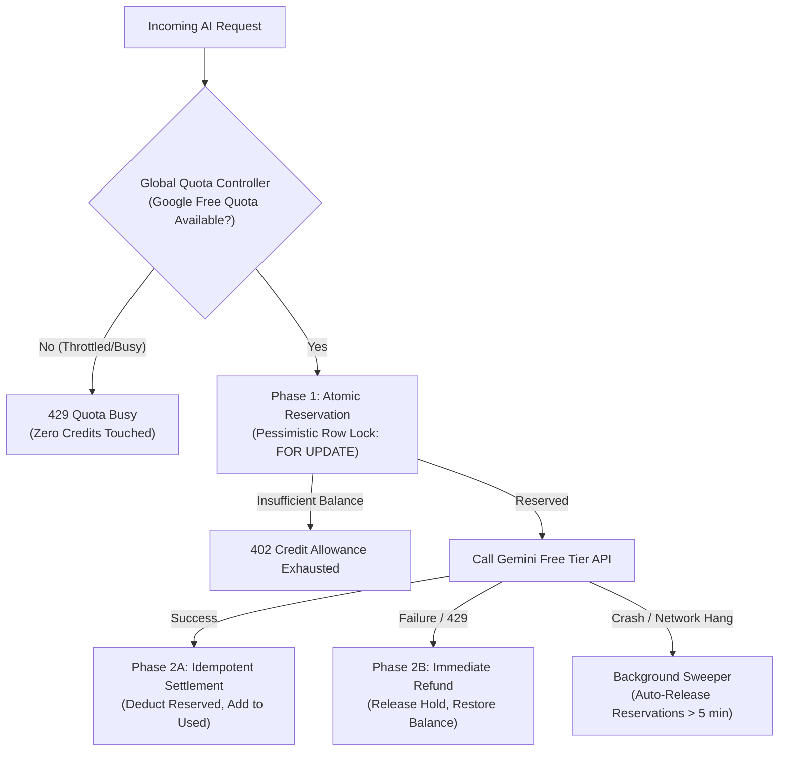

# SAUCER — AI CREDIT LEDGER & USAGE ENFORCEMENT ENGINE

This document specifies the enterprise credit accounting engine, concurrency locking, idempotent settlement, race-condition mitigations, and zombie-reservation recovery for **Saucer AI**.

---

## 1. Credit Ledger Philosophy & Decoupled Architecture



### 1.1 Decoupling Credits from External Quota
- **Internal User Credits**: Entitlement tokens allocated monthly according to the customer's plan (Free: 50, Pro: 500, Agency: 2,500).
- **External Google Quotas**: Physical system capacity limits imposed by Google AI Studio (e.g. 15 RPM).
- **Guaranteed Isolation**: Having available user credits **never** guarantees that a generation can proceed if the external Google API quota is saturated. If Google free-tier capacity is busy, the user request is rejected safely before credits are permanently charged.

---

## 2. Hardened Relational Data Models

```prisma
model AiCreditBalance {
  id              String       @id @default(uuid())
  organizationId  String       @unique
  totalAllowance  Int          // Base monthly allowance by subscription tier
  usedCredits     Int          @default(0)
  reservedCredits Int          @default(0) // Locked during active in-flight calls
  bonusCredits    Int          @default(0) // Non-expiring bonus credits (if purchased)
  resetAt         DateTime     // Next monthly billing reset timestamp
  updatedAt       DateTime     @updatedAt

  organization    Organization @relation(fields: [organizationId], references: [id], onDelete: Cascade)

  @@index([organizationId])
}

model AiCreditTransaction {
  id             String             @id @default(uuid())
  organizationId String
  amount         Int                // Credits involved (negative for deductions/holds)
  type           CreditTxType       // RESERVATION, COMMIT, REFUND, ALLOCATION, EXPIRED_RELEASE
  status         CreditTxStatus     // PENDING, SETTLED, CANCELLED, EXPIRED
  feature        String             // "caption_generation", "thread_generator", "rewriter"
  model          String             // "gemini-3.8-flash", "gemini-3.5-flash-lite"
  inputTokens    Int                @default(0)
  outputTokens   Int                @default(0)
  idempotencyKey String             @unique // UUID generated by client/gateway
  expiresAt      DateTime           // Auto-expiry timestamp (now + 5 minutes)
  metadata       String?            // JSON diagnostic data
  createdAt      DateTime           @default(now())
  updatedAt      DateTime           @updatedAt

  organization   Organization       @relation(fields: [organizationId], references: [id], onDelete: Cascade)

  @@index([organizationId, createdAt])
  @@index([status, expiresAt])
  @@index([idempotencyKey])
}

enum CreditTxType {
  ALLOCATION
  RESERVATION
  COMMIT
  REFUND
  EXPIRED_RELEASE
}

enum CreditTxStatus {
  PENDING
  SETTLED
  CANCELLED
  EXPIRED
}
```

---

## 3. Concurrency Protection & Race Condition Fixes

### 3.1 Race Condition Mitigations
1. **Pessimistic Locking (`SELECT FOR UPDATE`)**: Multiple parallel requests from the same organization (e.g. multi-tab users or concurrent agency editors) are serialized at the database row level.
2. **Explicit Available Balance Calculation**:
   $$\text{Available} = (\text{totalAllowance} + \text{bonusCredits}) - (\text{usedCredits} + \text{reservedCredits})$$
   A request is rejected if $\text{Available} < \text{Required}$.
3. **Idempotency Keys**: Every request carries an `idempotencyKey`. If a client retries due to network blips, duplicate reservations are rejected.
4. **Strict State Transitions**:
   - `PENDING` $\to$ `SETTLED` (via `settleCredits`)
   - `PENDING` $\to$ `CANCELLED` (via `refundCredits`)
   - `PENDING` $\to$ `EXPIRED` (via `recoverExpiredReservations`)
   - Attempting to settle an already settled, cancelled, or expired transaction is a no-op.

---

## 4. Hardened Credit Ledger Service Implementation

```typescript
@Injectable()
export class CreditService {
  private readonly logger = new Logger(CreditService.name);

  constructor(private prisma: PrismaService) {}

  /**
   * Phase 1: Atomic Reservation with Pessimistic Lock
   */
  async reserveCredits(
    orgId: string,
    requiredCredits: number,
    feature: string,
    idempotencyKey: string,
    modelName: string
  ): Promise<string> {
    return this.prisma.$transaction(
      async (tx) => {
        // 1. Idempotency pre-check
        const existingTx = await tx.aiCreditTransaction.findUnique({
          where: { idempotencyKey },
        });
        if (existingTx) {
          if (existingTx.status === CreditTxStatus.PENDING) {
            return existingTx.id;
          }
          throw new ConflictException('Transaction with this idempotency key already completed');
        }

        // 2. Lock balance row to eliminate race conditions
        const [balance] = await tx.$queryRaw<AiCreditBalance[]>`
          SELECT * FROM "AiCreditBalance"
          WHERE "organizationId" = ${orgId}
          FOR UPDATE
        `;

        if (!balance) {
          throw new NotFoundException('Credit balance record not found for workspace');
        }

        const available =
          balance.totalAllowance +
          balance.bonusCredits -
          (balance.usedCredits + balance.reservedCredits);

        if (available < requiredCredits) {
          throw new ForbiddenException({
            code: 'INSUFFICIENT_AI_CREDITS',
            message: 'Monthly AI allowance exhausted. Quota resets on billing anniversary.',
            available,
            required: requiredCredits,
          });
        }

        // 3. Increment reserved credits
        await tx.aiCreditBalance.update({
          where: { organizationId: orgId },
          data: {
            reservedCredits: { increment: requiredCredits },
          },
        });

        // 4. Create PENDING reservation record with 5-minute expiry
        const createdTx = await tx.aiCreditTransaction.create({
          data: {
            organizationId: orgId,
            amount: -requiredCredits,
            type: CreditTxType.RESERVATION,
            status: CreditTxStatus.PENDING,
            feature,
            model: modelName,
            idempotencyKey,
            expiresAt: new Date(Date.now() + 5 * 60 * 1000), // 5 minutes TTL
          },
        });

        return createdTx.id;
      },
      { timeout: 10000 } // 10s transaction timeout
    );
  }

  /**
   * Phase 2A: Idempotent Settlement
   */
  async settleCredits(
    transactionId: string,
    tokens: { inputTokens: number; outputTokens: number }
  ): Promise<void> {
    await this.prisma.$transaction(async (tx) => {
      // Lock the transaction row
      const [txRecord] = await tx.$queryRaw<AiCreditTransaction[]>`
        SELECT * FROM "AiCreditTransaction"
        WHERE "id" = ${transactionId}
        FOR UPDATE
      `;

      if (!txRecord) {
        this.logger.warn(`Settlement ignored: Transaction ${transactionId} not found`);
        return;
      }

      // Idempotency check: only settle if PENDING
      if (txRecord.status !== CreditTxStatus.PENDING) {
        this.logger.warn(`Settlement ignored: Transaction ${transactionId} is already in state ${txRecord.status}`);
        return;
      }

      const credits = Math.abs(txRecord.amount);

      // Lock and update balance
      await tx.aiCreditBalance.update({
        where: { organizationId: txRecord.organizationId },
        data: {
          reservedCredits: { decrement: credits },
          usedCredits: { increment: credits },
        },
      });

      // Finalize transaction
      await tx.aiCreditTransaction.update({
        where: { id: transactionId },
        data: {
          status: CreditTxStatus.SETTLED,
          type: CreditTxType.COMMIT,
          inputTokens: tokens.inputTokens,
          outputTokens: tokens.outputTokens,
        },
      });
    });
  }

  /**
   * Phase 2B: Safe Refund / Rollback
   */
  async refundCredits(transactionId: string, reason = 'Execution failed'): Promise<void> {
    await this.prisma.$transaction(async (tx) => {
      const [txRecord] = await tx.$queryRaw<AiCreditTransaction[]>`
        SELECT * FROM "AiCreditTransaction"
        WHERE "id" = ${transactionId}
        FOR UPDATE
      `;

      if (!txRecord || txRecord.status !== CreditTxStatus.PENDING) {
        return;
      }

      const credits = Math.abs(txRecord.amount);

      // Restore reserved balance
      await tx.aiCreditBalance.update({
        where: { organizationId: txRecord.organizationId },
        data: {
          reservedCredits: { decrement: credits },
        },
      });

      // Mark transaction as CANCELLED
      await tx.aiCreditTransaction.update({
        where: { id: transactionId },
        data: {
          status: CreditTxStatus.CANCELLED,
          type: CreditTxType.REFUND,
          metadata: JSON.stringify({ reason }),
        },
      });
    });
  }

  /**
   * Zombie Reservation Recovery Sweeper
   * Runs every 2 minutes via background scheduler
   */
  async recoverExpiredReservations(): Promise<number> {
    const expiredTxs = await this.prisma.aiCreditTransaction.findMany({
      where: {
        status: CreditTxStatus.PENDING,
        expiresAt: { lt: new Date() },
      },
      take: 50,
    });

    let recoveredCount = 0;
    for (const expTx of expiredTxs) {
      try {
        await this.refundCredits(expTx.id, 'Reservation expired / Process crashed');
        recoveredCount++;
      } catch (err) {
        this.logger.error(`Failed to recover expired transaction ${expTx.id}: ${err.message}`);
      }
    }

    if (recoveredCount > 0) {
      this.logger.log(`Recovered ${recoveredCount} expired AI reservations safely.`);
    }
    return recoveredCount;
  }
}
```

---

## 5. Monthly Allowance Reset & Bonus Credit Rollover

1. **Scheduled Reset Job**: Evaluates accounts where `resetAt <= NOW()`.
2. **Operations**:
   - `usedCredits` is reset to `0`.
   - Any residual `reservedCredits` are reconciled.
   - `totalAllowance` is synchronized with the current active subscription tier.
   - `bonusCredits` (non-expiring top-ups) remain intact and roll over indefinitely.
   - `resetAt` advances to the next month's billing anniversary date.
   - An `ALLOCATION` record is logged in `AiCreditTransaction`.
