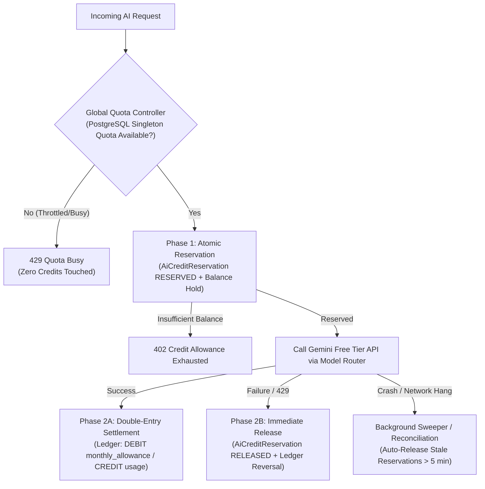

# SAUCER — AI CREDIT LEDGER & USAGE ENFORCEMENT ENGINE

This document specifies the enterprise credit accounting engine, concurrency locking, idempotent settlement, race-condition mitigations, and zombie-reservation recovery for **Saucer AI**.

---

## 1. Credit Ledger Philosophy & Decoupled Architecture



### 1.1 Decoupling Credits from External Quota
- **Internal User Credits**: Entitlement tokens allocated monthly according to the customer's plan (Free: 50, Pro: 500, Agency: 2,500, Enterprise: 10,000).
- **External Google Quotas**: Physical system capacity limits imposed by Google AI Studio (15 RPM, 1,000,000 TPM, 1,500 RPD).
- **Guaranteed Isolation**: Having available user credits **never** guarantees that a generation can proceed if the external Google API quota is saturated. If Google free-tier capacity is busy, the user request is rejected safely before credits are permanently charged.

---

## 2. Hardened Relational Data Models (Double-Entry Architecture)

As required by financial auditability, operational reservation state is separated from append-only immutable accounting entries:

```prisma
// Fast balance lookup and operational cache
model AiCreditBalance {
  id                 String       @id @default(uuid())
  organizationId     String       @unique
  monthlyAllowance   Int          @default(50)
  monthlyUsed        Int          @default(0)
  reservedCredits    Int          @default(0)
  purchasedCredits   Int          @default(0)
  billingPeriodStart DateTime     @default(now())
  billingPeriodEnd   DateTime
  createdAt          DateTime     @default(now())
  updatedAt          DateTime     @updatedAt

  organization       Organization @relation(fields: [organizationId], references: [id], onDelete: Cascade)

  @@index([organizationId])
}

// Operational request lifecycle state
model AiCreditReservation {
  id                String            @id @default(uuid())
  organizationId    String
  userId            String
  operation         String
  requestedCredits  Int
  reservationStatus ReservationStatus @default(RESERVED)
  idempotencyKey    String            @unique
  createdAt         DateTime          @default(now())
  expiresAt         DateTime
  settledAt         DateTime?

  organization      Organization      @relation(fields: [organizationId], references: [id], onDelete: Cascade)

  @@index([organizationId, reservationStatus])
  @@index([idempotencyKey])
}

// Append-only immutable double-entry accounting records
model AiCreditLedgerEntry {
  id             String       @id @default(uuid())
  organizationId String
  reservationId  String?
  entryType      LedgerEntryType
  debitAccount   String
  creditAccount  String
  amount         Int
  model          String?
  feature        String?
  inputTokens    Int          @default(0)
  outputTokens   Int          @default(0)
  providerCost   Float        @default(0.0) // 0.00 on free tier
  idempotencyKey String       @unique
  createdAt      DateTime     @default(now())

  organization   Organization @relation(fields: [organizationId], references: [id], onDelete: Cascade)

  @@index([organizationId, createdAt])
  @@index([reservationId])
  @@index([idempotencyKey])
}

enum ReservationStatus {
  RESERVED
  COMMITTED
  RELEASED
  EXPIRED
  RECONCILIATION_REQUIRED
}

enum LedgerEntryType {
  MONTHLY_ALLOCATION
  CREDIT_PURCHASE
  RESERVATION_HOLD
  USAGE_SETTLEMENT
  RESERVATION_RELEASE
  PLAN_CHANGE_ADJUSTMENT
  ADMIN_ADJUSTMENT
}
```

---

## 3. Immutability Enforcement & PostgreSQL Triggers

To prevent any application-level `UPDATE` or `DELETE` on finalized ledger entries, a PostgreSQL trigger is enforced at the database level:

```sql
CREATE OR REPLACE FUNCTION prevent_ai_ledger_modifications()
RETURNS TRIGGER AS $$
BEGIN
  IF TG_OP = 'UPDATE' THEN
    RAISE EXCEPTION 'AiCreditLedgerEntry is append-only: updates are prohibited on finalized entries (id: %)', OLD.id;
  END IF;
  IF TG_OP = 'DELETE' THEN
    RAISE EXCEPTION 'AiCreditLedgerEntry is append-only: deletions are prohibited on finalized entries (id: %)', OLD.id;
  END IF;
  RETURN NULL;
END;
$$ LANGUAGE plpgsql;

CREATE TRIGGER no_update_ai_ledger
BEFORE UPDATE OR DELETE ON "AiCreditLedgerEntry"
FOR EACH ROW EXECUTE FUNCTION prevent_ai_ledger_modifications();
```

---

## 4. Double-Entry Accounting Rules

Every credit movement creates matching debit and credit accounts in `AiCreditLedgerEntry`:

| Transaction Type | Debit Account | Credit Account | Description |
| :--- | :--- | :--- | :--- |
| **Monthly Allocation** | `system:allowance_pool` | `org:<id>:monthly_allowance` | Credited on renewal/signup |
| **Credit Purchase** | `system:purchased_pool` | `org:<id>:purchased_credits` | One-time non-expiring credit packs |
| **Reservation Hold** | `org:<id>:monthly_allowance` | `org:<id>:reserved_hold` | Locked during AI generation call |
| **Usage Settlement** | `org:<id>:reserved_hold` | `system:ai_usage` | Finalized consumption upon API success |
| **Reservation Release**| `org:<id>:reserved_hold` | `org:<id>:monthly_allowance` | Released back upon failure/timeout |

---

## 5. Fixed Operation Costs

Costs are strictly defined server-side and cannot be overridden by frontend payloads:

| Feature | Cost (Credits) | Justification |
| :--- | :--- | :--- |
| `caption` | **1 credit** | Lightweight single-post copy generation |
| `hashtags` | **1 credit** | Extraction of targeted hashtags and emojis |
| `rewrite` | **1 credit** | In-editor tone adjustment or rephrasing |
| `adapt` | **2 credits** | Generates 3 platform-tailored variations (X, LinkedIn, IG) |
| `thread` | **3 credits** | Multi-post narrative generation (5-10 interconnected posts) |
| `vision` | **2 credits** | Multi-modal image analysis and contextual captioning |
| `calendar` | **5 credits** | Multi-day content strategy and scheduling matrix |

---

## 6. Concurrency & Idempotency Safeguards

1. **Unique Idempotency Key**: Each reservation receives a client- or server-generated idempotency key (UUIDv4). If a request is retried, the existing reservation is returned without double-decrementing balances.
2. **Pessimistic Row Locking**: In PostgreSQL/Prisma, balance queries and updates use transactional locks to prevent race conditions during concurrent API calls.
3. **Atomic State Transitions**: A reservation can transition from `RESERVED` to `COMMITTED` or `RELEASED` only once. Subsequent duplicate settlement attempts are no-ops.
4. **Monthly Reset & Rollover**: At the billing period boundary, `monthlyUsed` is reset to 0, `monthlyAllowance` is refreshed to the subscription plan level, and non-expiring `purchasedCredits` are strictly preserved.
