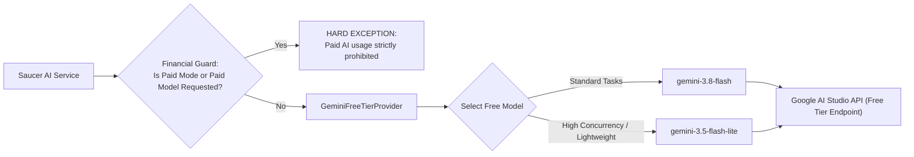

# SAUCER — AI PROVIDER ARCHITECTURE (FREE-TIER-ONLY SPECIFICATION)

This document specifies the technical architecture, SDK implementation, structured output schemas, and financial safety guards of the **Free-Tier Google Gemini Provider** for Saucer.

---

## 1. Architectural Mandate & Financial Guardrails



### 1.1 Non-Negotiable Financial Guards
1. **Billing Prohibition**: The provider strictly forbids configuring or passing Google Cloud Billing Account IDs or paid enterprise project numbers.
2. **Model Whitelist**: The provider contains a hard-coded whitelist: only `gemini-3.8-flash` and `gemini-3.5-flash-lite` are accepted. Any request for a non-whitelisted model (e.g., `gemini-2.5-pro`, `gpt-4o`, `claude-3-5-sonnet`) throws an immediate runtime `FinancialGuardException`.
3. **No Automatic Upgrades**: Under no circumstances will a quota rejection trigger an automatic failover to paid tiers or secondary paid providers.

---

## 2. Model Configuration & Profile

```typescript
export const FREE_TIER_MODELS = {
  PRIMARY: 'gemini-3.8-flash',
  LIGHTWEIGHT: 'gemini-3.5-flash-lite',
} as const;

export type AllowedFreeModel = typeof FREE_TIER_MODELS[keyof typeof FREE_TIER_MODELS];
```

### 2.1 Capability Mapping
- **`gemini-3.8-flash`**:
  - Primary interactive generator for captions, hashtags, tone shifting, multi-platform adaptation, thread creation, and content calendar brainstorming.
  - Native multi-modal vision: analyzes uploaded image attachments (JPEG, PNG, WebP) up to free payload limits.
- **`gemini-3.5-flash-lite`**:
  - Secondary low-resource model. Utilized during high-concurrency periods or for simple tasks (e.g. single-sentence tone rewrite or hashtag extraction) to conserve token quota.

---

## 3. Provider Implementation (`GeminiFreeTierProvider`)

```typescript
import { Injectable, Logger } from '@nestjs/common';
import { GoogleGenAI, Type } from '@google/genai';

export interface FreeTierGenerationOptions {
  model?: AllowedFreeModel;
  temperature?: number;
  maxOutputTokens?: number;
  systemInstruction?: string;
  responseSchema?: Record<string, any>;
}

export interface FreeTierGenerationResult<T = any> {
  data: T;
  rawText: string;
  inputTokens: number;
  outputTokens: number;
  modelUsed: string;
}

@Injectable()
export class GeminiFreeTierProvider {
  private readonly logger = new Logger(GeminiFreeTierProvider.name);
  private readonly ai: GoogleGenAI;

  constructor() {
    const apiKey = process.env.GEMINI_API_KEY;
    if (!apiKey) {
      throw new Error('GEMINI_API_KEY is missing. Google AI Studio unpaid key required.');
    }

    // Financial check: reject any key containing enterprise billing identifiers
    if (process.env.GOOGLE_BILLING_ACCOUNT_ID || process.env.ENABLE_PAID_AI === 'true') {
      throw new Error('FATAL: Paid AI configuration detected. Saucer must run on unpaid free tier only.');
    }

    this.ai = new GoogleGenAI({ apiKey });
  }

  /**
   * Generates structured text using Gemini structured JSON outputs
   */
  async generateStructured<T>(
    prompt: string,
    schema: Record<string, any>,
    options: FreeTierGenerationOptions = {}
  ): Promise<FreeTierGenerationResult<T>> {
    const model = this.validateAndSelectModel(options.model);

    try {
      const response = await this.ai.models.generateContent({
        model,
        contents: prompt,
        config: {
          systemInstruction: options.systemInstruction,
          temperature: options.temperature ?? 0.7,
          maxOutputTokens: options.maxOutputTokens ?? 1024,
          responseMimeType: 'application/json',
          responseSchema: schema,
        },
      });

      const rawText = response.text || '{}';
      const parsedData: T = JSON.parse(rawText);
      const usage = response.usageMetadata;

      return {
        data: parsedData,
        rawText,
        inputTokens: usage?.promptTokenCount || 0,
        outputTokens: usage?.candidatesTokenCount || 0,
        modelUsed: model,
      };
    } catch (error) {
      this.handleGoogleApiError(error, model);
    }
  }

  /**
   * Multi-modal image understanding (Image-to-Caption & Alt-Text)
   */
  async generateVision(
    imageBuffer: Buffer,
    mimeType: string,
    prompt: string,
    options: FreeTierGenerationOptions = {}
  ): Promise<FreeTierGenerationResult<string>> {
    const model = this.validateAndSelectModel(options.model);

    try {
      const response = await this.ai.models.generateContent({
        model,
        contents: [
          {
            inlineData: {
              data: imageBuffer.toString('base64'),
              mimeType,
            },
          },
          { text: prompt },
        ],
        config: {
          systemInstruction: options.systemInstruction,
          temperature: options.temperature ?? 0.4,
          maxOutputTokens: options.maxOutputTokens ?? 512,
        },
      });

      const rawText = response.text || '';
      const usage = response.usageMetadata;

      return {
        data: rawText,
        rawText,
        inputTokens: usage?.promptTokenCount || 0,
        outputTokens: usage?.candidatesTokenCount || 0,
        modelUsed: model,
      };
    } catch (error) {
      this.handleGoogleApiError(error, model);
    }
  }

  /**
   * Validates model against strict free-tier whitelist
   */
  private validateAndSelectModel(requestedModel?: string): AllowedFreeModel {
    if (!requestedModel) {
      return FREE_TIER_MODELS.PRIMARY;
    }

    if (
      requestedModel !== FREE_TIER_MODELS.PRIMARY &&
      requestedModel !== FREE_TIER_MODELS.LIGHTWEIGHT
    ) {
      this.logger.warn(`Rejected unauthorized model: ${requestedModel}. Defaulting to ${FREE_TIER_MODELS.PRIMARY}`);
      return FREE_TIER_MODELS.PRIMARY;
    }

    return requestedModel as AllowedFreeModel;
  }

  /**
   * Standardizes Google API error codes into Saucer domain exceptions
   */
  private handleGoogleApiError(error: any, model: string): never {
    const message = error?.message || '';
    const status = error?.status || error?.code;

    if (status === 429 || message.includes('RESOURCE_EXHAUSTED') || message.includes('quota')) {
      this.logger.warn(`Google AI Studio free quota exhausted for model ${model}: ${message}`);
      throw new GoogleQuotaExhaustedException(
        'Google AI Studio free-tier capacity is temporarily busy. Please retry in a few moments.'
      );
    }

    if (status === 400 || message.includes('INVALID_ARGUMENT')) {
      this.logger.error(`Invalid argument passed to Gemini API: ${message}`);
      throw new AiBadRequestException('The provided AI prompt or image could not be processed.');
    }

    this.logger.error(`Upstream Gemini API error: ${message}`);
    throw new GoogleApiUnavailableException('AI service is temporarily unavailable.');
  }
}

export class GoogleQuotaExhaustedException extends Error {
  constructor(message: string) {
    super(message);
    this.name = 'GoogleQuotaExhaustedException';
  }
}

export class AiBadRequestException extends Error {
  constructor(message: string) {
    super(message);
    this.name = 'AiBadRequestException';
  }
}

export class GoogleApiUnavailableException extends Error {
  constructor(message: string) {
    super(message);
    this.name = 'GoogleApiUnavailableException';
  }
}
```

---

## 4. Structured Output Schemas

Using Gemini's native `responseSchema` ensures that responses adhere to JSON structures with zero syntax breakage:

### 4.1 Caption Generation Schema
```json
{
  "type": "object",
  "properties": {
    "caption": { "type": "string", "description": "The tailored social media post caption" },
    "hashtags": {
      "type": "array",
      "items": { "type": "string" },
      "description": "3-5 relevant hashtags including hash symbol"
    },
    "characterCount": { "type": "integer" }
  },
  "required": ["caption", "hashtags", "characterCount"]
}
```

### 4.2 Multi-Platform Adaptation Schema
```json
{
  "type": "object",
  "properties": {
    "x": {
      "type": "object",
      "properties": {
        "text": { "type": "string", "description": "Concise post under 280 characters" },
        "hashtags": { "type": "array", "items": { "type": "string" } }
      },
      "required": ["text", "hashtags"]
    },
    "linkedin": {
      "type": "object",
      "properties": {
        "text": { "type": "string", "description": "Professional storytelling post" },
        "hashtags": { "type": "array", "items": { "type": "string" } }
      },
      "required": ["text", "hashtags"]
    },
    "instagram": {
      "type": "object",
      "properties": {
        "caption": { "type": "string", "description": "Visual post caption with emoji accents" },
        "firstComment": { "type": "string", "description": "Hashtags for first comment" }
      },
      "required": ["caption", "firstComment"]
    }
  },
  "required": ["x", "linkedin", "instagram"]
}
```

