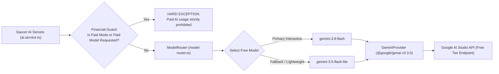

# SAUCER — AI PROVIDER ARCHITECTURE (FREE-TIER SPECIFICATION)

This document specifies the technical architecture, SDK implementation, structured output schemas, and financial safety guards of the **Free-Tier Google Gemini Provider** for Saucer.

---

## 1. Architectural Mandate & Financial Guardrails



### 1.1 Non-Negotiable Financial Guards
1. **Billing Prohibition**: The provider strictly forbids configuring or passing Google Cloud Billing Account IDs or paid enterprise project numbers.
2. **Model Whitelist**: The provider and router enforce a whitelist: only `gemini-3.8-flash` and `gemini-3.5-flash-lite` are accepted. Any request for a non-whitelisted model (e.g., `gemini-2.5-pro`, `gpt-4o`, `claude-3-5-sonnet`) throws an immediate runtime `FinancialGuardException`.
3. **No Automatic Upgrades**: Under no circumstances will a quota rejection trigger an automatic failover to paid tiers or secondary paid providers.
4. **Server-Side Key Isolation**: `GEMINI_API_KEY` is read strictly from `process.env.GEMINI_API_KEY` in server context. It is never prefixed with `NEXT_PUBLIC_` and never transmitted to client bundles.

---

## 2. Model Routing & Fallback

Implemented in `src/lib/ai/model-router.ts`:

```typescript
export const FREE_TIER_MODELS = {
  PRIMARY: 'gemini-3.8-flash',
  FALLBACK: 'gemini-3.5-flash-lite',
} as const;

export type AllowedFreeModel = (typeof FREE_TIER_MODELS)[keyof typeof FREE_TIER_MODELS];

export class ModelRouter {
  static getExecutionPlan(feature: string, requestedModel?: string): {
    primaryModel: AllowedFreeModel;
    fallbackModel: AllowedFreeModel | null;
  } {
    // Enforce free tier only
    let primary: AllowedFreeModel = FREE_TIER_MODELS.PRIMARY;
    if (requestedModel && Object.values(FREE_TIER_MODELS).includes(requestedModel as AllowedFreeModel)) {
      primary = requestedModel as AllowedFreeModel;
    }

    const fallback: AllowedFreeModel | null =
      primary === FREE_TIER_MODELS.PRIMARY ? FREE_TIER_MODELS.FALLBACK : null;

    return { primaryModel: primary, fallbackModel: fallback };
  }
}
```

---

## 3. Provider Implementation (`src/lib/ai/providers/gemini.provider.ts`)

Built using the official `@google/genai` SDK:

```typescript
import { GoogleGenAI } from '@google/genai';

export class GeminiProvider {
  private client: GoogleGenAI;

  constructor() {
    const apiKey = process.env.GEMINI_API_KEY;
    if (!apiKey) throw new Error('GEMINI_API_KEY environment variable is not set');
    this.client = new GoogleGenAI({ apiKey });
  }

  async generateText(options: GeminiGenerationOptions): Promise<GeminiGenerationResult> {
    // 15-second timeout race
    const timeoutPromise = new Promise<never>((_, reject) =>
      setTimeout(() => reject(new Error('AI generation timed out after 15s')), 15000)
    );

    const callPromise = this.client.models.generateContent({
      model: options.model,
      contents: options.prompt,
      config: {
        systemInstruction: options.systemInstruction,
        temperature: options.temperature ?? 0.7,
        maxOutputTokens: options.maxOutputTokens ?? 1024,
        responseMimeType: options.responseMimeType,
      },
    });

    const response = await Promise.race([callPromise, timeoutPromise]);
    // Extract text, token counts, and enforce safe JSON parsing
  }

  async generateWithVision(options: GeminiVisionOptions): Promise<GeminiGenerationResult> {
    // Multimodal input with inlineData base64 image inspection
  }
}
```

---

## 4. Prompt Registry & Zod Schema Validation

Located in `src/lib/ai/prompt-registry.ts` and `src/lib/ai/types.ts`:
- **Strict Zod Schemas**: Every response schema (`CaptionResponseSchema`, `HashtagsResponseSchema`, `RewriteResponseSchema`, `AdaptResponseSchema`, `ThreadResponseSchema`, `VisionResponseSchema`, `CalendarResponseSchema`) validates the parsed JSON.
- **Fail-Safe Credit Protection**: If the response is malformed or violates the schema, `ai.service.ts` immediately catches the validation error, aborts the operation, and invokes `creditService.releaseReservation()` so that customer credits are not consumed.
