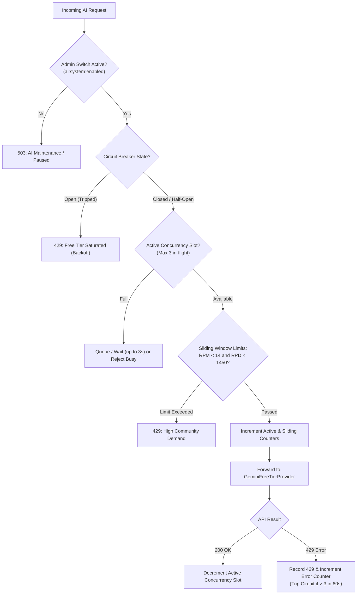

# SAUCER — GLOBAL AI QUOTA CONTROLLER & TRAFFIC MANAGEMENT

This document specifies the global traffic control, rate-limiting, concurrency gating, circuit-breaking, and administrative controls implemented to protect Saucer within **Google AI Studio's Free-Tier Quotas**.

---

## 1. The Challenge of Unpaid Free-Tier API Operation

Google AI Studio's unpaid tier provides generous model access but enforces strict, hard-capped project quotas:
- **Requests Per Minute (RPM)**: Typically capped at **15 RPM** across the entire project.
- **Tokens Per Minute (TPM)**: Typically capped at **1,000,000 TPM** for Flash models.
- **Requests Per Day (RPD)**: Capped at **1,500 RPD**.
- **Burst Limits**: Exceeding 15 requests in a 60-second window triggers immediate HTTP 429 `RESOURCE_EXHAUSTED`.

If 50 Saucer users click "Generate Caption" simultaneously, without a centralized controller, Google will instantly block the project with 429 errors.

---

## 2. Global AI Usage Controller Architecture

The **Global AI Usage Controller** sits in front of the AI provider and acts as an intelligent traffic valve:



---

## 3. Core Protection Mechanisms

### 3.1 Concurrency Limiter (Semaphore via Redis)
To prevent sudden spikes that trigger Google's instant burst rate-limiters:
- **Max Concurrent Global Requests**: Fixed at **3 concurrent active requests** across the entire Saucer platform.
- If 3 requests are actively awaiting responses from Gemini, the 4th request waits in an async Redis queue for up to 3,000ms. If no slot frees up, it fails-fast with a friendly `"Free tier busy"` message, keeping customer credits untouched.

### 3.2 Sliding-Window Rate Limiters (Redis Sorted Sets)
- **RPM Window**: 60-second rolling window. Capped at **13 RPM** (providing a safety buffer below Google's 15 RPM limit).
- **RPD Counter**: 24-hour UTC counter. Capped at **1,400 RPD** (saving a 100-request buffer for critical system tasks).

### 3.3 Jittered Exponential Backoff
When Google returns an unexpected 429 or transient network timeout:
1. Backoff formula: $t_{\text{wait}} = \min(t_{\text{max}}, t_{\text{base}} \times 2^{\text{attempt}}) \pm \text{random\_jitter}$
2. Max retry attempts: **1 retry only**. Long retry chains in user-facing web requests degrade user experience and tie up connections. If the single retry fails, return immediate failure.

### 3.4 Circuit Breaker
- If the backend receives **three 429 responses within 60 seconds**, the circuit breaker transitions to **OPEN**.
- While OPEN, all AI requests fail immediately at the gateway for **30 seconds** without hitting Google's servers. This gives Google's rate-limiter bucket time to replenish.
- After 30 seconds, it enters **HALF-OPEN**; if a canary request succeeds, the circuit returns to **CLOSED**.

### 3.5 Administrative Kill-Switch
- Stored in Redis key `ai:system:enabled` (and fallback env var `AI_GLOBAL_ENABLED`).
- Administrators can toggle this switch in the admin console to pause all AI traffic instantly during platform incidents, maintenance, or quota resets without redeploying code.

---

## 4. Implementation: `GlobalAiQuotaController`

```typescript
import { Injectable, Logger } from '@nestjs/common';
import { Redis } from 'ioredis';
import { InjectRedis } from '@nestjs-modules/ioredis';

@Injectable()
export class GlobalAiQuotaController {
  private readonly logger = new Logger(GlobalAiQuotaController.name);

  // Safety caps below Google's hard limits
  private readonly MAX_CONCURRENT = 3;
  private readonly MAX_RPM = 13; // Google limit: 15
  private readonly MAX_RPD = 1400; // Google limit: 1500

  constructor(@InjectRedis() private readonly redis: Redis) {}

  /**
   * Evaluates all global quota gates before an API call is made
   */
  async acquireSlot(): Promise<() => Promise<void>> {
    // 1. Check Administrative Master Switch
    const isEnabled = await this.redis.get('ai:system:enabled');
    if (isEnabled === 'false' || process.env.AI_GLOBAL_ENABLED === 'false') {
      throw new AiServicePausedException('AI features are temporarily paused for maintenance.');
    }

    // 2. Check Circuit Breaker
    const circuitState = await this.redis.get('ai:circuit:state');
    if (circuitState === 'OPEN') {
      throw new AiQuotaBusyException(
        'Google free-tier capacity is currently saturated. Service will resume in 30 seconds.'
      );
    }

    // 3. Check Daily Quota (RPD)
    const today = new Date().toISOString().slice(0, 10);
    const rpdCount = parseInt((await this.redis.get(`ai:rpd:${today}`)) || '0', 10);
    if (rpdCount >= this.MAX_RPD) {
      throw new AiQuotaBusyException(
        'The global free-tier daily AI quota has been reached. Quota resets at 00:00 UTC.'
      );
    }

    // 4. Check Minute Sliding Window (RPM)
    const now = Date.now();
    const oneMinuteAgo = now - 60000;
    const rpmKey = 'ai:rpm:sliding';

    await this.redis.zremrangebyscore(rpmKey, 0, oneMinuteAgo);
    const currentRpm = await this.redis.zcard(rpmKey);

    if (currentRpm >= this.MAX_RPM) {
      throw new AiQuotaBusyException(
        'AI generation demand is high across the platform. Please retry in 15 seconds.'
      );
    }

    // 5. Acquire Concurrency Semaphore
    const activeConcurrency = await this.redis.incr('ai:concurrency:active');
    if (activeConcurrency > this.MAX_CONCURRENT) {
      await this.redis.decr('ai:concurrency:active');
      throw new AiQuotaBusyException(
        'All free AI worker slots are currently in use. Please retry in a few moments.'
      );
    }

    // Register this request into the sliding window and daily counter
    await this.redis.zadd(rpmKey, now, `${now}-${Math.random()}`);
    await this.redis.incr(`ai:rpd:${today}`);
    await this.redis.expire(`ai:rpd:${today}`, 86400 * 2);

    // Return the release function to be called in a finally block
    return async () => {
      await this.redis.decr('ai:concurrency:active');
    };
  }

  /**
   * Trips the circuit breaker if 429s are detected
   */
  async reportQuotaExhausted(): Promise<void> {
    this.logger.warn('429 RESOURCE_EXHAUSTED reported from Google AI Studio.');
    const errorCount = await this.redis.incr('ai:circuit:errors');
    await this.redis.expire('ai:circuit:errors', 60);

    if (errorCount >= 3) {
      this.logger.error('Circuit breaker TRIPPED to OPEN state for 30 seconds.');
      await this.redis.set('ai:circuit:state', 'OPEN', 'EX', 30);
      await this.redis.del('ai:circuit:errors');
    }
  }
}

export class AiQuotaBusyException extends Error {
  constructor(message: string) {
    super(message);
    this.name = 'AiQuotaBusyException';
  }
}

export class AiServicePausedException extends Error {
  constructor(message: string) {
    super(message);
    this.name = 'AiServicePausedException';
  }
}
```

---

## 5. UI Messaging & Failure User Experience

When `AiQuotaBusyException` or `AiServicePausedException` is caught:
1. **HTTP Status Code**: Returns `HTTP 429 Too Many Requests` (or `HTTP 503 Service Unavailable`).
2. **Payload**:
   ```json
   {
     "status": "quota_busy",
     "message": "Saucer AI is currently experiencing high community demand under our free tier. Your credits were not charged. Please retry in 30 seconds.",
     "retryAfterSeconds": 30
   }
   ```
3. **UI Toast**: Composer displays an amber status banner rather than a jarring error modal, reassuring the user that their monthly credit allowance was safely preserved.

