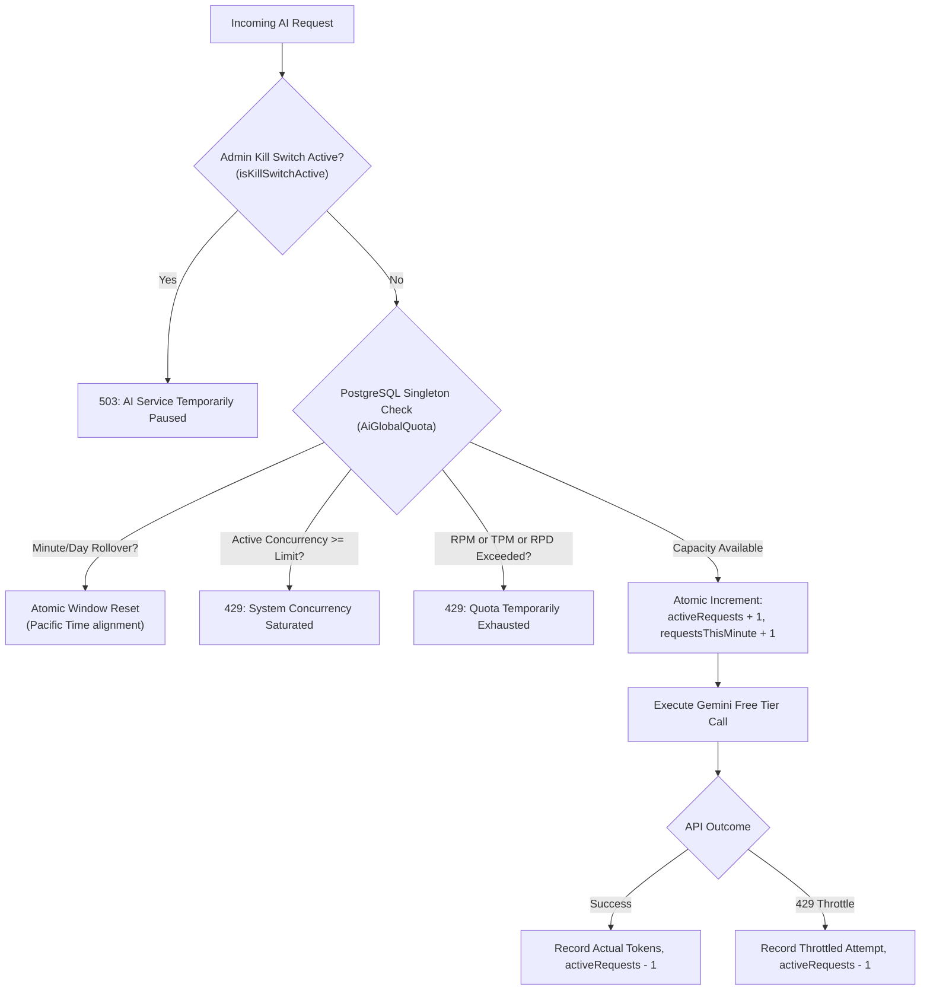

# SAUCER — GLOBAL AI QUOTA CONTROLLER & TRAFFIC MANAGEMENT

This document specifies the global traffic control, rate-limiting, concurrency gating, circuit-breaking, and administrative controls implemented to protect Saucer within **Google AI Studio's Free-Tier Quotas**.

---

## 1. The Challenge of Unpaid Free-Tier API Operation

Google AI Studio's unpaid tier provides free model access but enforces strict, hard-capped project quotas:
- **Requests Per Minute (RPM)**: Defaulted to **15 RPM** across the entire project.
- **Tokens Per Minute (TPM)**: Defaulted to **1,000,000 TPM** for Flash models.
- **Requests Per Day (RPD)**: Capped at **1,500 RPD**.
- **Daily Reset**: Resets at midnight Pacific Time (PT).
- **Burst Limits**: Exceeding 15 requests in a 60-second window triggers immediate HTTP 429 `RESOURCE_EXHAUSTED`.

Because serverless functions (e.g. Next.js on Vercel) run on stateless separate instances, in-memory counters cannot prevent quota exhaustion.

---

## 2. PostgreSQL Distributed Quota Controller Architecture

Saucer uses a persistent, distributed quota coordination mechanism backed by a PostgreSQL singleton table (`AiGlobalQuota`):



---

## 3. Persistent Database Model (`AiGlobalQuota`)

```prisma
model AiGlobalQuota {
  id                   String   @id @default("global-quota-controller")
  rpmLimit             Int      @default(15)
  requestsThisMinute   Int      @default(0)
  currentMinuteWindow  DateTime @default(now())
  tpmLimit             Int      @default(1000000)
  tokensThisMinute     Int      @default(0)
  rpdLimit             Int      @default(1500)
  requestsToday        Int      @default(0)
  currentDayWindow     DateTime @default(now())
  maxConcurrency       Int      @default(5)
  activeRequests       Int      @default(0)
  isKillSwitchActive   Boolean  @default(false)
  killSwitchReason     String?
  updatedAt            DateTime @updatedAt
}
```

---

## 4. Quota Enforcement Logic (`src/lib/ai/quota-controller.ts`)

1. **Atomic Window Resets**:
   - Minute Window: Evaluated using `Math.floor(Date.now() / 60000)`. If changed, `requestsThisMinute` and `tokensThisMinute` reset to 0.
   - Day Window: Formatted in `America/Los_Angeles` timezone (`YYYY-MM-DD`). If the calendar day in Pacific Time changes, `requestsToday` resets to 0.
2. **Concurrency Gating**:
   - Caps concurrent in-flight requests at `maxConcurrency` (default 5). If full, requests are rejected with status 429 and `retryAfterSeconds: 5`.
3. **RPM / TPM / RPD Gating**:
   - If `requestsThisMinute >= rpmLimit` or `requestsToday >= rpdLimit`, returns 429 with computed retry delay until the window resets.
4. **Administrative Kill Switch**:
   - If `isKillSwitchActive === true`, immediately rejects all AI calls with 503 before any external call or credit reservation.
5. **Release & Token Settlement**:
   - When the AI call completes, `GlobalQuotaController.releaseQuota(tokensUsed)` decrements `activeRequests` and accumulates `tokensThisMinute`.
