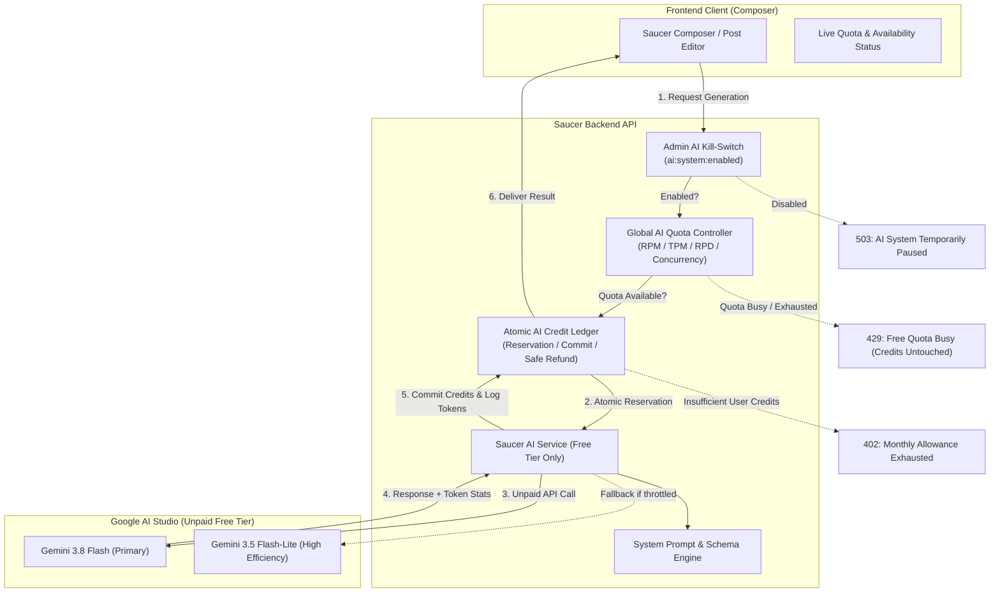

# SAUCER AI — SYSTEM ARCHITECTURE & FREE-TIER SPECIFICATION

> [!IMPORTANT]
> **STRICT ZERO-BUDGET FINANCIAL DIRECTIVE**:
> Saucer AI operates **exclusively within publicly available free API quotas** through Google AI Studio's unpaid API tier. Paid billing, paid models, paid fallback providers, automatic tier upgrades, and paid image/video generation are strictly forbidden.

---

## 1. System Vision & Zero-Cost Architecture

Saucer provides an AI-assisted social media workflow without incurring external API expenses. The backend orchestrates requests to the **Google Gemini API** using an unpaid API key provisioned via **Google AI Studio**.

---

## 2. Strict Financial Restrictions & Non-Negotiable Guardrails

To prevent any possibility of unexpected cloud charges:
1. **Zero Paid Billing**: No credit card or billing account is attached to the Google Cloud / Google AI Studio project.
2. **Zero Paid Models**: Pro/ultra models (e.g. Gemini 2.5 Pro, Gemini 1.5 Pro) and paid endpoints are disabled.
3. **Zero Paid Fallbacks**: If free quotas are exhausted, requests fail gracefully with an informative user message; the system **never** fails over to paid APIs (OpenAI, Anthropic, AWS Bedrock).
4. **Zero Tier Escalation**: The application code has no mechanism to request billing upgrades or switch API keys dynamically to paid tiers.
5. **No Paid Image or Video Models**: DALL-E, Imagen, Fal AI, Flux, Sora, and RunPod GPU services are removed. All media generation features are deferred.
6. **Pre-flight Quota Gate**: Requests are evaluated against local Redis rate-limiters before hitting Google's servers, protecting against API bans.

---

## 3. Model Inventory & Selection

Saucer targets currently supported free-tier models in Google AI Studio:

| Model Identifier | Tier Role | Capabilities | Free-Tier Quota Profile |
| :--- | :--- | :--- | :--- |
| **Gemini 3.8 Flash** | **Primary Interactive Model** | High speed, rich social fluency, structured JSON, multi-modal image understanding. | ~15 RPM, 1,000,000 TPM, 1,500 RPD |
| **Gemini 3.5 Flash-Lite** | **High-Efficiency Model** | Ultra-lightweight, rapid response, optimal for low-complexity text transforms. | ~15 RPM, 250,000 TPM, 1,500 RPD |

> [!NOTE]
> Older generation models (such as Gemini 2.5 Flash and Gemini 2.5 Pro) are not assumed to be available for new free-tier projects and are excluded from configuration defaults.

---

## 4. Prioritized Feature Set (Free Models Only)

All active AI capabilities are strictly confined to text transformation and free-tier multi-modal image inspection:

1. **Caption Generation**:
   - Generates engaging, network-specific captions from topics, keywords, or raw outlines.
   - Enforces character limits: 280 characters for X, 500 for Threads/Mastodon, 3,000 for LinkedIn.
2. **Hashtag Suggestions**:
   - Contextual extraction of relevant niche and trending hashtags in structured JSON arrays.
3. **Text Rewriting & Polishing**:
   - In-editor sentence refactoring, shortening, expanding, or improving clarity.
4. **Tone Adjustment**:
   - Dynamic tone shifts: Professional, Casual/Authentic, Bold/Contrarian, Humorous, Concise.
5. **Multi-Platform Adaptation**:
   - Single prompt simultaneously outputs tailored variants for X, LinkedIn, and Instagram.
6. **Thread Creation**:
   - Generates cohesive 5–10 post storytelling threads for X and Bluesky.
7. **Content Calendar Ideation**:
   - Generates weekly thematic post concepts and scheduling slots.
8. **Multi-Modal Vision (Image Understanding & Alt-Text)**:
   - Evaluates user-uploaded image attachments using Gemini Flash's native vision input.
   - Outputs scene descriptions, auto-generated captions, and WCAG-compliant accessibility alt-text.
9. **Deferred Features**:
   - AI video generation (RunPod/Sora) and synthetic image generation (DALL-E/Flux) are deferred until sustainable commercial funding or free open alternatives exist.

---

## 5. Separation of User Credits vs. Global API Quota

A fundamental tenet of Saucer AI:
- **Customer Credits**: Measure internal subscription entitlements (e.g. Free plan gets 50 credits/month).
- **Global Google Quota**: The hard external capacity shared across all users by Google AI Studio (e.g. 15 requests per minute globally).

> [!WARNING]
> A customer having 500 credits **does not guarantee** that Google's free API is ready to accept a request at that specific second. The UI must never promise instantaneous execution without checking the Global Quota Controller.

When global quotas are reached:
1. Customer credits are **not** charged.
2. Any held/reserved credits are **immediately released**.
3. The UI displays: *"Saucer AI is currently experiencing high community demand under our free tier. Please retry in 30 seconds."*

---

## 6. Failure Behavior & 429 Handling

When Google AI Studio returns `429 Too Many Requests` or `RESOURCE_EXHAUSTED`:
- The provider catches the error without bubbling unhandled exceptions.
- The Global Quota Controller triggers a 30-second backoff circuit.
- The reservation in the `CreditLedger` is aborted via `refundCredits()`.
- An audit entry records the throttled attempt for capacity planning.
- The user is notified clearly with zero impact to their monthly allowance.
