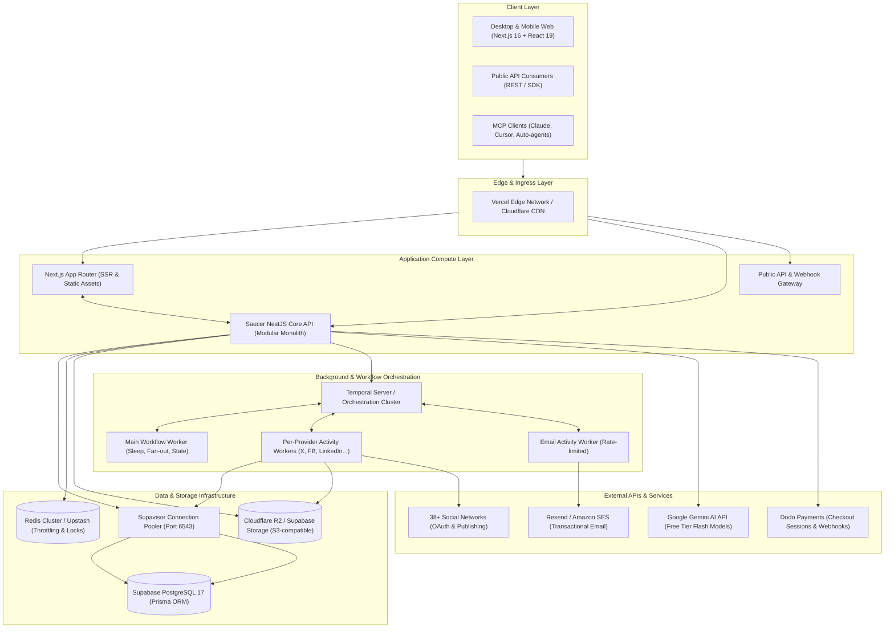

# SAUCER — MASTER SOFTWARE ARCHITECTURE

This document specifies the complete software architecture for **Saucer**, an AI-powered social media management SaaS platform. It synthesizes findings from the audit of the **Postiz** reference codebase and defines the target engineering architecture for Saucer.

---

## 1. High-Level Architecture Topology

Saucer adopts a modern, distributed, service-oriented architecture designed to decouple interactive web requests from long-running, rate-limited, and durable background operations.

---

## 2. Frontend Architecture

### 2.1 Technology Foundations
- **Framework**: Next.js 16 (App Router) with React 19.
- **Language**: TypeScript (strict mode enabled).
- **Styling**: Tailwind CSS with CSS Variables for theme tokens.
- **Component Primitives**: Radix UI headless components styled via `shadcn/ui`.
- **Iconography**: Lucide React.
- **State Management**:
  - Server state caching & mutation: SWR / React Query.
  - Local composer & UI state: Zustand stores (e.g., active accounts, multi-channel overrides, draft synchronization).
- **Rich Text Editor**: TipTap (ProseMirror-based) with custom extensions for mentions, hashtags, bold, italic, code blocks, and character counters tailored to network-specific constraints.

### 2.2 Design System & Visual Hierarchy
Saucer avoids superficial rebranding. It introduces an original, modern SaaS aesthetic:
- **Clean Neutral Palette**: Slate/Zinc surfaces with purposeful brand accents.
- **High-Information Density**: Purpose-built for power creators and agency teams managing dozens of accounts simultaneously.
- **Live Platform Previews**: Real-time canvas rendering accurate simulations of posts on X (Twitter), LinkedIn, Instagram, Facebook, TikTok, Threads, and Pinterest.
- **Responsive Navigation**: Collapsible sidebar, unified global search, quick-switcher for multi-tenant workspaces, and contextual action command palettes (`Cmd+K`).

---

## 3. Backend Architecture (Core API)

### 3.1 Framework & Modular Design
Saucer retains and elevates the **NestJS** backend architecture from the reference codebase. NestJS provides:
- First-class TypeScript support with dependency injection.
- Modular architecture allowing clean separation of concerns.
- Strong controller-service-repository patterns.
- Robust middleware, interceptors, exception filters, and decorators.

### 3.2 Modular Breakdown
The backend is structured into domain-specific modules:
- `AuthModule`: Local registration, bcrypt hashing, session cookies, OAuth callbacks, password reset tokens.
- `OrganizationsModule`: Workspaces, team memberships, role assignments, branding.
- `IntegrationsModule`: OAuth handshakes, token exchange, credential encryption, channel health checks, settings.
- `PostsModule`: Post creation, multi-platform validation, draft lifecycle, queue dispatching.
- `CalendarModule`: Range queries, day/week/month aggregation, drag-and-drop date rescheduling.
- `AiModule`: Gemini client abstraction, prompt registry, token cost measurement, credit checking.
- `CreditModule`: Server-side credit ledger, two-phase reservation and settlement engine.
- `BillingModule`: Dodo Payments Checkout Sessions integration, plan pricing, webhook processing.
- `MediaModule`: Chunked upload processing, S3 presigned URLs, MIME validation, thumbnail generation.
- `AnalyticsModule`: Data aggregation per channel, post performance metrics, audience history.
- `AutomationsModule`: RSS feed ingestion, scheduling triggers, outgoing webhook dispatching.

### 3.3 Authorization & Policy Enforcement
Authorization is governed by **CASL (Code Access Security Layer)**:
- Requests carry authenticated user and active organization contexts extracted via `AuthMiddleware`.
- Route handlers declare required permissions using the `@CheckPolicies` decorator.
- `PermissionsGuard` invokes `PermissionsService`, checking both:
  1. **User Role within Organization**: `SUPERADMIN`, `ADMIN`, or `USER`.
  2. **Subscription Tier Entitlements**: Active channel limits, posts-per-month quotas, team collaboration seats, and AI feature flags.
- This dual-check guarantees that users cannot bypass subscription limits even if they have admin privileges in their workspace.

---

## 4. Background Processing & Workflow Orchestration

### 4.1 Evaluation of Workflow Solutions

A rigorous evaluation of background job architectures was conducted during the Milestone 1 audit:

| Evaluation Dimension | Option A: Temporal (Reference) | Option B: Inngest | Option C: BullMQ + Redis |
| :--- | :--- | :--- | :--- |
| **Execution Model** | Durable virtual execution (V8 isolates) | Serverless event-driven step execution | Queue-based Redis task dispatch |
| **Sleep / Delay Accuracy** | Unlimited durable `sleep(ms)` without holding connections | Durable step sleep via HTTP triggers | Redis `delayed` z-set (memory overhead) |
| **Worker Concurrency** | Exact per-provider task queues (e.g. `reddit`, `x`) | Event concurrency keys | BullMQ worker concurrency settings |
| **Failure Recovery** | Automatic state recovery from execution history | Step-level retries | Job retry with custom backoff |
| **Operational Overhead** | Requires Temporal cluster (Self-hosted or Cloud) | Fully managed SaaS | Requires Redis persistence & management |
| **Migration Risk** | **Zero migration risk**; reference code is battle-tested | High; requires rewriting all workflow code | High; requires custom idempotency logic |
| **Recommendation** | **Retain Temporal** for Phase 1; preserve battle-tested post workflows | Evaluate for serverless-only deployments | Not recommended for durable scheduled workflows |

### 4.2 Temporal Workflow Architecture in Saucer
Temporal is retained as the workflow engine for Saucer due to the mission-critical nature of social media publishing:
1. **Deterministic Post Workflow (`postWorkflowV112`)**:
   - Long-running workflow sleeps until the scheduled `publishDate`.
   - On wake-up, checks if the post or channel was modified or canceled.
   - Triggers pre-flight OAuth token refresh if expiration is imminent.
   - Dispatches mutations to provider-specific task queues.
2. **Dedicated Per-Provider Task Queues**:
   - Activities execute on isolated queues: `x`, `linkedin`, `facebook`, `instagram`, `youtube`, `tiktok`, `reddit`, etc.
   - Allows strict global concurrency limits (e.g., maximum 1 concurrent request for sensitive APIs, preventing account rate-limit bans).
3. **Heartbeat Timeouts & Double-Publishing Prevention**:
   - Irreversible publishing activities heartbeat every 15 seconds.
   - Activities that time out without heartbeats indicate worker death before API call execution, allowing safe retry.
   - Timeouts occurring *after* API dispatch are flagged as "Outcome Unknown", alerting the user rather than risking an embarrassing duplicate post.
4. **Idempotency & Conflict Policy**:
   - Workflows are keyed by `workflowId: post_${postId}`.
   - Re-scheduling a post terminates the prior workflow using `workflowIdConflictPolicy: 'TERMINATE_EXISTING'`.

---

## 5. Database Architecture & Multi-Tenancy

### 5.1 Supabase PostgreSQL & Connection Strategy
- **Primary Relational Store**: Supabase PostgreSQL 17.
- **ORM**: Prisma ORM 6.5.
- **Connection Management**:
  - **Transaction Pooler (Supavisor)** on port `6543`: Used by the NestJS API and background workers for standard high-concurrency queries.
  - **Direct Session Connection** on port `5432`: Reserved for Prisma schema migrations (`prisma db push` / `prisma migrate`).

### 5.2 Multi-Tenant Data Isolation
- Strict logical multi-tenancy is enforced at the application and repository layer.
- Every major business entity (`Post`, `Integration`, `Media`, `Customer`, `Subscription`, `Credits`, `Tags`, `Webhooks`) belongs to an `organizationId`.
- Repositories automatically enforce `where: { organizationId }` filtering on all CRUD operations.
- The active organization context is determined server-side from signed session state and cannot be spoofed by client headers.

---

## 6. AI Subsystem (Saucer AI)

### 6.1 Free-Tier Provider Architecture
Saucer operates exclusively on the unpaid free tier of Google AI Studio:
- **Models**:
  - `gemini-3.8-flash`: High-speed generation for captions, post ideas, hashtag recommendations, and vision analysis.
  - `gemini-3.5-flash-lite`: Low-resource model for simple rewrites and high-concurrency periods.
- **Global Quota Controller**: Enforces strict platform-wide limits (max 3 concurrent requests, 13 RPM, 1,400 RPD) via Redis semaphores and circuit breakers.

### 6.2 Credit Ledger & Concurrency Defense
- Every organization has an auditable credit ledger.
- Two-phase reservation:
  1. `reserveCredits(orgId, estimatedCredits)` acquires an atomic row lock (`SELECT ... FOR UPDATE`).
  2. If generation succeeds, `commitCredits(transactionId, tokenStats)` finalizes the record.
  3. If generation fails, times out, or triggers a 429 quota pause, `refundCredits(transactionId)` immediately releases the hold.
- Frontend never determines credit balance; all validation occurs server-side.

---

## 7. Storage & Media Processing

### 7.1 Object Storage
- Default production storage: **Cloudflare R2** (S3-compatible, zero egress fees).
- Alternative/development storage: **Supabase Storage** or local disk storage.
- Storage operations are abstracted behind a unified `StorageService`.

### 7.2 Media Pipeline
- Web uploads generate signed presigned URLs for direct browser-to-bucket upload, minimizing API server memory pressure.
- Backend verifies uploaded media using magic-byte sniffing (`file-type`).
- Media processing activities optimize images (Sharp) and validate video durations and codecs (H.264 mp4) prior to social platform dispatch.

---

## 8. Billing & Monetization Architecture

- **Exclusive Payment Provider**: **Dodo Payments**.
- **Checkout Experience**: Hosted Dodo Payments Checkout Sessions for recurring subscriptions and one-time AI credit packs.
- **Webhook Gateway**: Dedicated endpoint `/api/v1/billing/dodo/webhook` with mandatory cryptographic signature validation.
- **Entitlement Sync**: Verified webhooks update the `Subscription` and `AiCreditBalance` tables atomically, synchronizing CASL policy checks immediately across all active user sessions.
