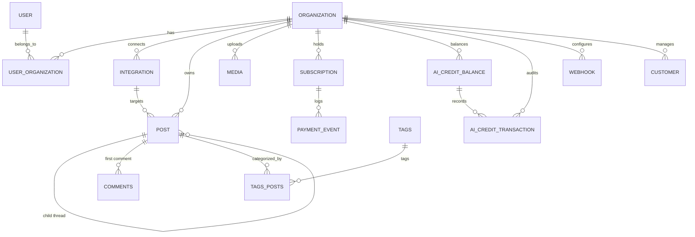

# SAUCER — DATABASE ARCHITECTURE & SCHEMA SPECIFICATION

This document details the database architecture, Prisma ORM schema design, multi-tenant isolation strategy, and migration roadmap for **Saucer**, hosted on **Supabase PostgreSQL 17**.

---

## 1. Reference Codebase Database Audit

An exhaustive audit of `libraries/nestjs-libraries/src/database/prisma/schema.prisma` from the reference Postiz codebase reveals 87 distinct Prisma models. These models belong to distinct historical phases of the reference codebase's evolution:

### 1.1 Model Categorization Matrix

| Classification | Models | Architectural Assessment for Saucer |
| :--- | :--- | :--- |
| **A. Core Multi-Tenant SaaS** | `User`, `Organization`, `UserOrganization`, `UsedCodes`, `Media`, `Tags`, `TagsPosts`, `Announcement` | **Preserve & Enhance**. Essential foundation for authentication, multi-tenancy, workspaces, user profiles, and media. |
| **B. Publishing & Scheduling** | `Post`, `Comments`, `Signatures`, `Sets`, `AutoPost`, `Mentions`, `Errors` | **Preserve & Enhance**. Core publishing lifecycle, versioning, grouping, first-comments, channel presets, RSS autoposting, and failure tracing. |
| **C. Social Integrations & OAuth** | `Integration`, `Customer`, `ThirdParty`, `Webhooks`, `IntegrationsWebhooks`, `OAuthApp`, `OAuthAuthorization`, `OAuthSelfHostedAuthorization` | **Preserve & Standardize**. Channel tokens, refresh tokens, client branding, short-link tools, incoming/outgoing webhooks, and MCP OAuth. |
| **D. Monetization & Usage** | `Subscription`, `Customer`, `Credits` | **Evolve into Enterprise Architecture**. Retain base subscription structures; replace Stripe/RevenueCat specifics with **Dodo Payments**; replace primitive `Credits` with an auditable double-entry `AiCreditLedger`. |
| **E. Video Clipping (AI)** | `Clipping`, `ClippingClip` | **Preserve for Phase 2**. Video clipping pipeline from YouTube/video files. |
| **F. Legacy Gitroom Marketplace** | `GitHub`, `Trending`, `TrendingLog`, `ItemUser`, `Star`, `SocialMediaAgency`, `SocialMediaAgencyNiche`, `Orders`, `OrderItems`, `PayoutProblems`, `Messages`, `MessagesGroup`, `Plugs`, `ExisingPlugData`, `PopularPosts` | **Prune / Deprecate**. Legacy peer-to-peer influencer marketplace and GitHub repository tracking from earlier Gitroom iterations. Not relevant to Saucer core SaaS. |
| **G. Mastra AI Framework** | 44 `mastra_*` models (`mastra_agents`, `mastra_workflows`, `mastra_memory`, `mastra_mcp_servers`, etc.) | **Isolate / Optional Module**. Embedded agent framework for MCP execution. Isolate from primary relational models to prevent schema bloat. |

---

## 2. Target Saucer Relational Architecture

The target database architecture for Saucer streamlines core SaaS models while introducing enterprise-grade structures for **Dodo Payments billing** and the **Saucer AI Credit Ledger**.



---

## 3. Core Models Specification

### 3.1 Organization & Multi-Tenancy

```prisma
model Organization {
  id                   String               @id @default(uuid())
  name                 String
  description          String?
  apiKey               String?              @unique
  dodoCustomerId       String?              // Dodo Payments Customer ID (cus_...)
  streakSince          DateTime?
  allowTrial           Boolean              @default(false)
  isTrailing           Boolean              @default(false)
  shortlink            ShortLinkPreference  @default(ASK)
  createdAt            DateTime             @default(now())
  updatedAt            DateTime             @updatedAt
  deletedAt            DateTime?

  // Relations
  users                UserOrganization[]
  integrations         Integration[]
  posts                Post[]               @relation("organization")
  media                Media[]
  subscriptions        Subscription?
  aiCreditBalances     AiCreditBalance?
  aiCreditTransactions AiCreditTransaction[]
  customers            Customer[]           // Client brand accounts
  webhooks             Webhooks[]
  autoposts            AutoPost[]
  signatures           Signatures[]
  sets                 Sets[]
  errors               Errors[]
  comments             Comments[]

  @@index([deletedAt])
  @@index([dodoCustomerId])
}

model User {
  id                    String             @id @default(uuid())
  email                 String             @unique
  password              String?            // Bcrypt hash for LOCAL provider
  providerName          Provider           @default(LOCAL)
  name                  String?
  lastName              String?
  isSuperAdmin          Boolean            @default(false)
  bio                   String?
  pictureId             String?
  providerId            String?            // External OAuth ID (Google, GitHub)
  timezone              Int                @default(0) // Offset in minutes
  timezoneName          String?            // e.g. "America/New_York", "Asia/Kolkata"
  activated             Boolean            @default(true)
  lastOnline            DateTime           @default(now())
  lastReadNotifications DateTime           @default(now())
  ip                    String?
  createdAt             DateTime           @default(now())
  updatedAt             DateTime           @updatedAt
  deletedAt             DateTime?

  organizations         UserOrganization[]
  comments              Comments[]

  @@index([email])
  @@index([providerName, providerId])
}

model UserOrganization {
  id             String       @id @default(uuid())
  userId         String
  organizationId String
  role           Role         @default(USER) // SUPERADMIN, ADMIN, USER, EDITOR
  disabled       Boolean      @default(false)
  createdAt      DateTime     @default(now())
  updatedAt      DateTime     @updatedAt

  organization   Organization @relation(fields: [organizationId], references: [id], onDelete: Cascade)
  user           User         @relation(fields: [userId], references: [id], onDelete: Cascade)

  @@unique([userId, organizationId])
  @@index([organizationId])
  @@index([userId])
}
```

### 3.2 Social Media Integrations

```prisma
model Integration {
  id                    String       @id @default(cuid())
  internalId            String       // Provider-scoped identifier
  organizationId        String
  name                  String       // Display handle (e.g. "@saucerapp")
  customName            String?
  picture               String?      // Avatar URL
  providerIdentifier    String       // e.g. "x", "linkedin-page", "instagram"
  type                  String       // e.g. "social", "channel"
  token                 String       // Encrypted OAuth access token
  refreshToken          String?      // Encrypted OAuth refresh token
  tokenExpiration       DateTime?
  disabled              Boolean      @default(false)
  refreshNeeded         Boolean      @default(false)
  inBetweenSteps        Boolean      @default(false)
  postingTimes          String       @default("[{\"time\":120}, {\"time\":400}, {\"time\":700}]")
  additionalSettings    String?      @default("[]") // JSON metadata (board IDs, subreddits)
  customerId            String?      // Optional client brand grouping
  createdAt             DateTime     @default(now())
  updatedAt             DateTime?    @updatedAt
  deletedAt             DateTime?

  organization          Organization @relation(fields: [organizationId], references: [id], onDelete: Cascade)
  customer              Customer?    @relation(fields: [customerId], references: [id], onDelete: SetNull)
  posts                 Post[]

  @@unique([organizationId, internalId, providerIdentifier])
  @@index([organizationId])
  @@index([disabled, refreshNeeded])
}
```

### 3.3 Publishing & Posts

```prisma
model Post {
  id                         String         @id @default(cuid())
  organizationId             String
  integrationId              String
  content                    String         // Rich caption / text body
  state                      State          @default(QUEUE) // DRAFT, QUEUE, PUBLISHED, ERROR
  publishDate                DateTime
  delay                      Int            @default(0)     // Seconds delay between thread items
  group                      String         // UUID linking variants of one scheduled broadcast
  batchId                    String?
  title                      String?        // Platform title (YouTube, Reddit, Dev.to)
  description                String?
  parentPostId               String?        // Thread parent ID
  releaseId                  String?        // Platform returned post ID (e.g. tweet ID)
  releaseURL                 String?        // Public permalink to published post
  settings                   String?        // JSON platform-specific overrides
  image                      String?        // JSON array of attached Media IDs
  creationMethod             CreationMethod @default(WEB) // WEB, API, MCP, AUTOPOST, CLI
  intervalInDays             Int?           // For recurring/evergreen publishing
  error                      String?        // Diagnostic error message if state == ERROR
  createdAt                  DateTime       @default(now())
  updatedAt                  DateTime       @updatedAt
  deletedAt                  DateTime?

  organization               Organization   @relation("organization", fields: [organizationId], references: [id], onDelete: Cascade)
  integration                Integration    @relation(fields: [integrationId], references: [id], onDelete: Cascade)
  parentPost                 Post?          @relation("parentPostId", fields: [parentPostId], references: [id], onDelete: Cascade)
  childrenPost               Post[]         @relation("parentPostId")
  tags                       TagsPosts[]
  comments                   Comments[]
  errors                     Errors[]

  @@index([group])
  @@index([publishDate])
  @@index([organizationId, publishDate, state, deletedAt])
  @@index([state])
}
```

### 3.4 Saucer AI Credit Ledger & Quota Control (Double-Entry Accounting)

```prisma
model AiCreditBalance {
  id                 String       @id @default(uuid())
  organizationId     String       @unique
  monthlyAllowance   Int          @default(50)
  monthlyUsed        Int          @default(0)
  reservedCredits    Int          @default(0)
  purchasedCredits   Int          @default(0)
  billingPeriodStart DateTime     @default(now())
  billingPeriodEnd   DateTime
  createdAt          DateTime     @default(now())
  updatedAt          DateTime     @updatedAt

  organization       Organization @relation(fields: [organizationId], references: [id], onDelete: Cascade)

  @@index([organizationId])
}

model AiCreditReservation {
  id                String            @id @default(uuid())
  organizationId    String
  userId            String
  operation         String
  requestedCredits  Int
  reservationStatus ReservationStatus @default(RESERVED)
  idempotencyKey    String            @unique
  createdAt         DateTime          @default(now())
  expiresAt         DateTime
  settledAt         DateTime?

  organization      Organization      @relation(fields: [organizationId], references: [id], onDelete: Cascade)

  @@index([organizationId, reservationStatus])
  @@index([idempotencyKey])
}

model AiCreditLedgerEntry {
  id             String          @id @default(uuid())
  organizationId String
  reservationId  String?
  entryType      LedgerEntryType
  debitAccount   String
  creditAccount  String
  amount         Int
  model          String?
  feature        String?
  inputTokens    Int             @default(0)
  outputTokens   Int             @default(0)
  providerCost   Float           @default(0.0) // 0.00 on free tier
  idempotencyKey String          @unique
  createdAt      DateTime        @default(now())

  organization   Organization    @relation(fields: [organizationId], references: [id], onDelete: Cascade)

  @@index([organizationId, createdAt])
  @@index([reservationId])
  @@index([idempotencyKey])
}

model AiGlobalQuota {
  id                  String   @id @default("global-quota-controller")
  rpmLimit            Int      @default(15)
  requestsThisMinute  Int      @default(0)
  currentMinuteWindow DateTime @default(now())
  tpmLimit            Int      @default(1000000)
  tokensThisMinute    Int      @default(0)
  rpdLimit            Int      @default(1500)
  requestsToday       Int      @default(0)
  currentDayWindow    DateTime @default(now())
  maxConcurrency      Int      @default(5)
  activeRequests      Int      @default(0)
  isKillSwitchActive  Boolean  @default(false)
  killSwitchReason    String?
  updatedAt           DateTime @updatedAt
}

enum ReservationStatus {
  RESERVED
  COMMITTED
  RELEASED
  EXPIRED
  RECONCILIATION_REQUIRED
}

enum LedgerEntryType {
  MONTHLY_ALLOCATION
  CREDIT_PURCHASE
  RESERVATION_HOLD
  USAGE_SETTLEMENT
  RESERVATION_RELEASE
  PLAN_CHANGE_ADJUSTMENT
  ADMIN_ADJUSTMENT
}
```

### 3.5 SaaS Subscriptions (Dodo Payments Integration)

```prisma
model Subscription {
  id                 String           @id @default(cuid())
  organizationId     String           @unique
  subscriptionTier   SubscriptionTier @default(FREE) // FREE, PRO, AGENCY, ENTERPRISE
  provider           String           @default("dodo")
  dodoSubscriptionId String?          @unique // Dodo Subscription ID (sub_...)
  dodoCustomerId     String?          // Dodo Customer ID (cus_...)
  dodoProductId      String?          // Dodo Product ID (pdt_...)
  status             SubStatus        @default(ACTIVE)
  cancelAt           DateTime?
  currentPeriodEnd   DateTime?
  period             Period           @default(MONTHLY)
  totalChannels      Int              @default(3)
  isLifetime         Boolean          @default(false)
  createdAt          DateTime         @default(now())
  updatedAt          DateTime         @updatedAt
  deletedAt          DateTime?

  organization       Organization     @relation(fields: [organizationId], references: [id], onDelete: Cascade)
  paymentEvents      PaymentEvent[]

  @@index([organizationId])
  @@index([dodoSubscriptionId])
  @@index([dodoCustomerId])
}

model PaymentEvent {
  id             String       @id // Webhook ID (from webhook-id header)
  subscriptionId String
  event          String       // e.g. "subscription.active", "payment.succeeded"
  payload        String       // Full JSON webhook payload
  signatureValid Boolean      @default(true)
  processedAt    DateTime     @default(now())

  subscription   Subscription? @relation(fields: [subscriptionId], references: [dodoSubscriptionId], onDelete: Cascade)

  @@index([subscriptionId])
  @@index([event])
}

enum SubStatus {
  ACTIVE
  PAST_DUE
  HALTED
  CANCELLED
  TRIALING
}
```

---

## 4. Supabase PostgreSQL Migration Strategy

### 4.1 Connection Topology
- **Application Traffic (NestJS API & Workers)**:
  - Connects to Supabase **Supavisor Transaction Pooler** via `DATABASE_URL` (Port `6543`).
  - Optimized for short-lived queries, connection reuse, and zero socket exhaustion under burst traffic.
- **Migration & Admin Traffic**:
  - Connects to Supabase **Direct PostgreSQL Session** via `DIRECT_URL` (Port `5432`).
  - Required for Prisma migration transactions and schema changes.

### 4.2 Row Level Security (RLS) Evaluation
- **Prisma Context**: Because NestJS connects using a dedicated database role with full schema access, PostgreSQL RLS policies do not replace backend authorization checks.
- **Defense in Depth**: Supabase RLS policies are created on sensitive tables (`User`, `Organization`, `Integration`, `Post`) with tenant scoping (`organization_id = auth.jwt() ->> 'org_id'`).
- **Zero-Trust Backend**: Every Prisma repository query strictly mandates `where: { organizationId }` derived from the validated server session.
