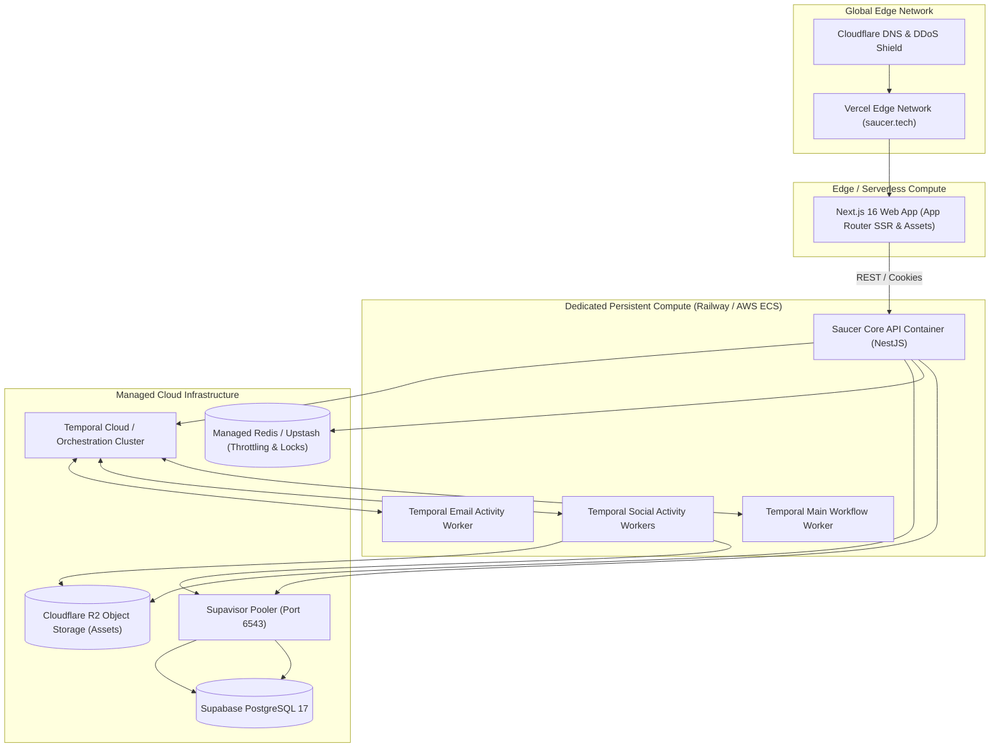
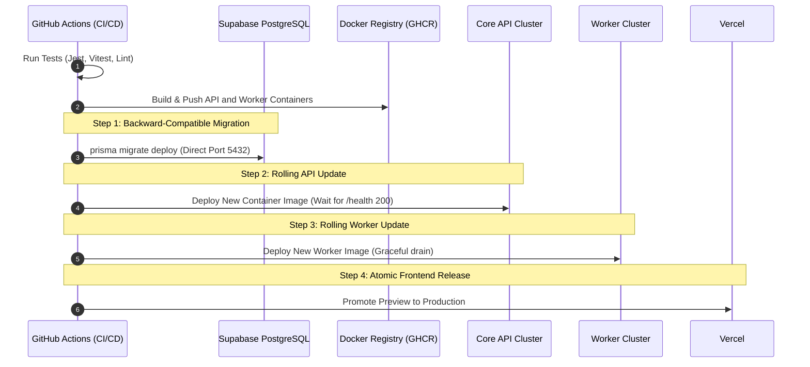

# SAUCER — HOSTING TOPOLOGY & DEPLOYMENT GUIDE

This document defines the production infrastructure topology, containerization strategy, zero-downtime migration protocols, and operational monitoring for **Saucer**.

---

## 1. Production Hosting Topology

The deployment architecture is engineered around the principle of **workload-appropriate compute**: lightweight interactive web assets are hosted on edge serverless infrastructure, while durable background workers and stateful APIs run on dedicated persistent compute.



### 1.1 Why Not Put Everything on Vercel?
A critical architectural conclusion of our audit:
- **Serverless Limits**: Vercel serverless functions have strict execution duration limits (15s–60s) and ephemeral lifecycles.
- **Workflow Sleep Requirements**: Social media scheduling requires long-running sleep states (often weeks in advance) and persistent socket heartbeats.
- **Worker Concurrency**: Providers like X (Twitter) mandate single-threaded concurrency per account to prevent rate-limit bans; serverless environments spin up uncoordinated parallel instances.
- **Therefore**: The **Frontend** runs on Vercel; the **Core API** and **Temporal Workers** run on persistent compute (Railway or AWS ECS).

---

## 2. Infrastructure Service Matrix

| Component | Target Platform | Sizing / Plan | Health Endpoint |
| :--- | :--- | :--- | :--- |
| **Frontend** | Vercel | Pro Plan (Custom Domain, Edge) | `/` |
| **Core API** | Railway / AWS ECS | 2 vCPU, 4GB RAM (Auto-scale) | `/health` (Port 3000) |
| **Orchestrator Worker** | Railway / AWS ECS | 2 vCPU, 4GB RAM (Persistent) | `/health` (Port 3002) |
| **PostgreSQL Database** | Supabase | Pro Plan (8GB RAM, High I/O) | Port 6543 (Pool) / 5432 |
| **Redis** | Upstash / Railway | Regional Cluster (Low Latency) | Port 6379 |
| **Object Storage** | Cloudflare R2 | Standard (S3-compatible, 0 egress)| Direct HTTPS CDN |
| **Workflow Engine** | Temporal Cloud | Standard Namespace | Port 7233 (mTLS) |

---

## 3. Environment Strategy

1. **Local Development**:
   - Orchestrated via `docker-compose.dev.yaml`: Local PostgreSQL 17, Redis 7, Local Temporal server, and local storage emulation.
   - Run via PNPM monorepo: `pnpm run dev` launches Frontend, Backend, and Orchestrator concurrently.
2. **Staging / Preview**:
   - Connected to isolated Supabase preview branches and sandbox credentials (Dodo Payments test_mode, Social Developer Sandboxes).
   - Vercel automatic branch preview deployments.
3. **Production**:
   - High-availability multi-region DNS (Cloudflare).
   - Strict SSL/TLS termination, mTLS on Temporal connections, AES-256-GCM token encryption at rest.

---

## 4. Zero-Downtime Deployment & Migration Protocol

To guarantee continuous availability during releases:



### 4.1 Safe Schema Migration Rules
- Schema changes must always be **backward compatible**.
- Never rename columns directly in production. Use a 3-step transition:
  1. Add new column (nullable or with default).
  2. Deploy code that writes to both columns and reads from new.
  3. Deprecate and drop old column in subsequent release.

---

## 5. Monitoring, Logging & Disaster Recovery

1. **Application Performance Monitoring (APM)**:
   - Sentry integrated across Frontend (`@sentry/nextjs`), Backend (`@sentry/nestjs`), and Orchestrator.
   - Transaction tracing and error grouping with sourcemap resolution.
2. **Database Backups & RPO/RTO**:
   - Supabase Point-in-Time Recovery (PITR) with continuous Write-Ahead Log (WAL) archiving.
   - RPO (Recovery Point Objective): < 1 minute.
   - RTO (Recovery Time Objective): < 15 minutes.
3. **Worker Liveness & Heartbeats**:
   - Healthcheck controllers on port `3002` verified every 10 seconds.
   - Temporal execution watchdog alerts if publishing lag exceeds 60 seconds.

---

## 6. Dodo Payments Webhook & Production Configuration

1. **Required Environment Variables**:
   ```ini
   DODO_PAYMENTS_API_KEY="your-dodo-api-key"
   DODO_PAYMENTS_WEBHOOK_KEY="your-dodo-webhook-signing-secret"
   DODO_PAYMENTS_ENVIRONMENT="test_mode" # Switch to live_mode only with operational sign-off
   DODO_PAYMENTS_RETURN_URL="https://saucer.tech/app/settings/billing"
   ```
2. **Webhook Endpoint URL**:
   Configure in the Dodo Payments Dashboard under Developer Webhooks:
   - Webhook URL: `https://saucer.tech/api/billing/webhook`
   - Subscribed Events: `subscription.active`, `subscription.renewed`, `subscription.updated`, `subscription.cancelled`, `subscription.failed`, `payment.succeeded`, `payment.failed`, `refund.succeeded`.
3. **Test Mode Isolation**:
   - Always verify new subscription product IDs in `test_mode` first using `scripts/test-dodo-billing.js`.


