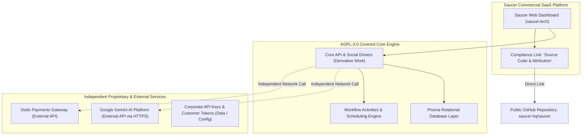

# SAUCER — LICENSING, AGPL-3.0 COMPLIANCE & ATTRIBUTION

This document provides a comprehensive legal and architectural compliance assessment regarding the use of the reference **Postiz** source code, the obligations under the **GNU Affero General Public License v3 (AGPL-3.0)**, and third-party dependency attribution for **Saucer**.

---

## 1. Executive Summary & Legal Guardrail

> [!WARNING]
> The Postiz reference codebase is licensed under the **GNU Affero General Public License v3.0 (AGPL-3.0)**. 
> Under international copyright law, copying, adapting, restructuring, translating, or rebranding AGPL-covered source code does **not** extinguish the copyleft obligations of the license. Any software incorporating or derived from this codebase inherits AGPL-3.0 obligations unless explicit dual-licensing rights are acquired from the copyright holders.

Saucer approaches this project with rigorous legal hygiene, ensuring complete transparency, copyright preservation, and compliance readiness.

---

## 2. Key Obligations of AGPL-3.0

### 2.1 Section 13: Remote Network Interaction (The "SaaS Clause")
Traditional GPL licenses trigger source distribution requirements only upon physical distribution of binaries (object code). **AGPL-3.0 Section 13** specifically closes the "Application Service Provider (ASP) loophole":

> *"Notwithstanding any other provision of this License, if you modify the Program, your modified version must prominently offer all users interacting with it remotely through a computer network... an opportunity to receive the Corresponding Source of your version by providing access to the Corresponding Source from a network server at no charge..."*

**Impact on Saucer as a SaaS Platform**:
- Users accessing Saucer via web browsers or API clients are considered "interacting with it remotely through a computer network."
- Saucer must provide a prominent, accessible mechanism (e.g., in the application footer and user settings) allowing users to download the Corresponding Source code of any AGPL-covered modules running on the server.

### 2.2 Preservation of Copyright Notices & Attribution
- All original copyright headers, notices, and attribution to **Gitroom / Postiz** and original contributors must remain intact within referenced and derivative source files.
- Modifying author names or deleting license headers is strictly prohibited.
- Saucer must maintain a public `ATTRIBUTION.md` or legal notice page detailing the lineage of the codebase.

---

## 3. Compliance Architecture for Saucer

To maintain full compliance while operating a commercial SaaS, Saucer implements the following compliance strategy:

### 3.1 Public Source Code Availability
- A public repository (`saucer-hq/saucer`) will host the corresponding source code of the application.
- A prominent link in the dashboard footer ("Legal & Open Source") will navigate directly to the exact commit SHA corresponding to the running production build.

### 3.2 Confidentiality of Commercial Secrets
- **Important Distinction**: AGPL-3.0 mandates disclosure of the **source code**, not private operational data, environment variables, customer databases, corporate API credentials, or customer tokens.
- Secret configuration variables (`.env`) and private keys remain strictly confidential and are excluded from the repository via `.gitignore`.

---

## 4. Third-Party Dependency License Audit

An audit of the top-level dependencies declared in the project reveals standard permissive open-source licenses compatible with AGPL-3.0:

| Dependency / Package | Declared License | Permitted Commercial SaaS Use |
| :--- | :--- | :---: |
| **Next.js** | MIT | ✅ Yes |
| **React / React-DOM** | MIT | ✅ Yes |
| **Tailwind CSS** | MIT | ✅ Yes |
| **NestJS Framework** | MIT | ✅ Yes |
| **Prisma ORM** | Apache 2.0 | ✅ Yes |
| **Temporal SDK** (`@temporalio/*`) | MIT | ✅ Yes |
| **TipTap Editor** (`@tiptap/*`) | MIT | ✅ Yes |
| **Lucide React** | ISC | ✅ Yes |
| **Sharp** | Apache 2.0 | ✅ Yes |
| **IoRedis** | MIT | ✅ Yes |
| **Zod / Class-Validator** | MIT | ✅ Yes |
| **Dayjs** | MIT | ✅ Yes |
| **Bcrypt** | MIT | ✅ Yes |

No restrictive GPL-incompatible or non-commercial (CC-BY-NC) libraries exist in the core runtime path.

