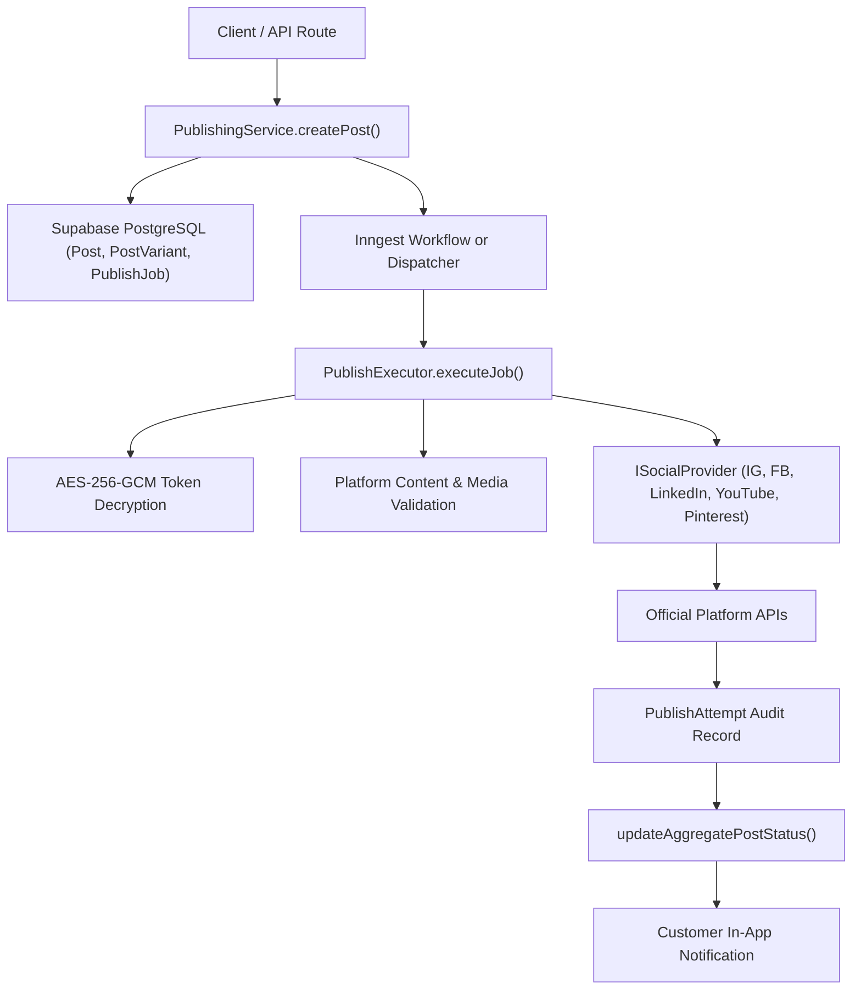

# SAUCER — Social Publishing Engine Specification

## 1. Architectural Overview
The Saucer Social Publishing Engine provides a fault-tolerant, multi-tenant broadcast infrastructure for social media channels. It coordinates platform-specific variant generation, cryptographic authorization, media handling, asynchronous container polling, and atomic state reconciliations.

---

## 2. Platform Drivers & Capabilities

| Platform | Provider Implementation | Primary API Version | Max Text Length | Media Constraints | Supported Formats |
| :--- | :--- | :--- | :--- | :--- | :--- |
| **Instagram** | `InstagramProvider` | Meta Graph API (Configurable, Default `v21.0`) | 2,200 chars | Media required (image/video) | Single Image, Carousel (10), Reels |
| **Facebook** | `FacebookProvider` | Meta Graph API (Configurable, Default `v21.0`) | 63,206 chars | Optional media | Feed Posts, Page Photos, Page Videos |
| **LinkedIn** | `LinkedInProvider` | LinkedIn REST Version `202610` (October 2026) | 3,000 chars | Optional media | Text, Single Image, Video, Document |
| **YouTube** | `YouTubeProvider` | YouTube Data API v3 (Upload Quota Bucket) | 5,000 chars (desc) | Video required | Standard Video, YouTube Shorts |
| **Pinterest** | `PinterestProvider` | Pinterest API v5 | 500 chars (desc) | Image/Video required | Pins, Video Pins, Board Selection |

---

## 3. Post & Platform Variant Separation
Saucer separates master post concepts from platform-specific variants:
- **`Post`**: Master content entity, workspace-scoped, tracks overall status, scheduled time, customer IANA timezone, and author.
- **`PostVariant`**: Platform-specific representation linked to a connected `SocialAccount`. Contains customized captions (e.g. hashtags for Instagram, professional commentary for LinkedIn), media configuration, and external post IDs.

---

## 4. Aggregate Post State Lifecycle

A post targeting multiple channels evaluates its state atomically:
- `DRAFT`: Saved in workspace, unscheduled.
- `SCHEDULED`: Scheduled for future date/time.
- `QUEUED`: Queued for background worker execution.
- `PUBLISHING`: Actively communicating with platform APIs.
- `PUBLISHED`: All targeted platform variants confirmed successful by providers.
- `PARTIALLY_PUBLISHED`: At least one variant succeeded and at least one variant failed.
- `FAILED`: All targeted platform variants failed.
- `CANCELLED`: Post and pending jobs cancelled before execution.

---

## 5. Security & Isolation
- **AES-256-GCM Token Encryption**: Provider access and refresh tokens are strictly encrypted at rest (`iv:authTag:ciphertext`). Plaintext tokens are decrypted strictly inside server-side workers during API calls and never exposed to the frontend.
- **Multi-Tenant RLS**: Row-Level Security in PostgreSQL enforces that users can only publish to social accounts owned by their authorized organization and workspace. Cross-organization targets are rejected with HTTP 403 Forbidden.
