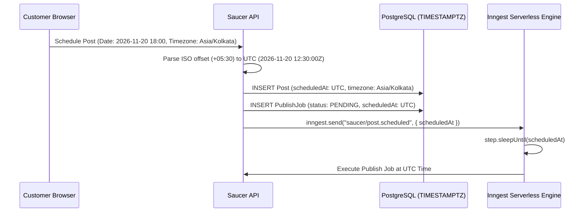

# SAUCER — Scheduling System Architecture

## 1. Overview
The Saucer Scheduling System orchestrates future, recurring, and immediate broadcasts while handling timezone conversions, daylight saving time adjustments, application deployments, and post modifications.

---

## 2. Timezone Handling & UTC Normalization
- **Storage Standard**: All scheduled timestamps (`scheduledAt`) are stored strictly in UTC with timezone offset in PostgreSQL (`TIMESTAMPTZ`).
- **Customer Timezone**: The customer's IANA timezone (e.g. `America/New_York`, `Asia/Kolkata`, `Europe/London`) is preserved in `Post.timezone` to allow recurring rules and daylight saving time calculations without drift.

---

## 3. Stale Job Prevention & Synchronization
When a customer edits or cancels a scheduled post:
1. `PublishingService.updatePost()` updates `Post.content` and adjusts `PublishJob.scheduledAt` for all pending jobs.
2. If `Post.status === 'CANCELLED'`, any worker waking up immediately aborts execution and marks the job `CANCELLED`.
3. If `Post.updatedAt > PublishJob.createdAt` in an asynchronous queue, worker reconciliation verifies and re-evaluates the latest version before dispatching to social APIs.

---

## 4. Visual Content Calendar Integration
The frontend Visual Calendar (`/app/calendar`) queries `/api/publishing/posts?view=calendar`:
- **Month View**: 7-column day grid highlighting today, showing count badges, and rendering platform-specific status pills.
- **Week & Day Views**: Detailed agenda list with timestamps, author metadata, and quick rescheduling actions.
- **Platform Filters**: Filter by channel (Instagram, Facebook, LinkedIn, YouTube, Pinterest) or view all simultaneously.
- **Rescheduling API**: Instant updates via `PATCH /api/publishing/posts/[id]` with new ISO timestamps.
