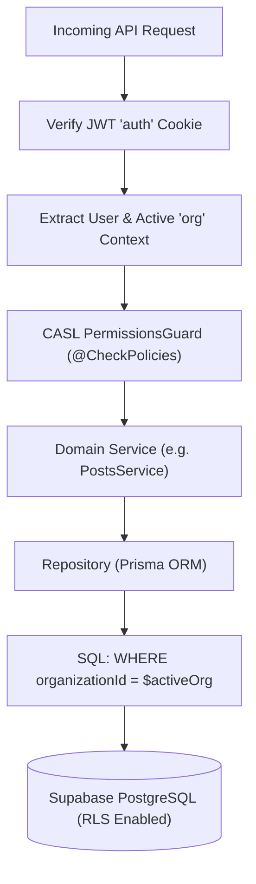
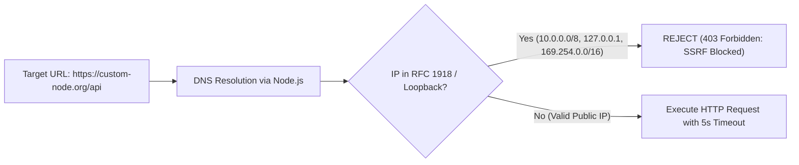

# SAUCER — SECURITY ARCHITECTURE & THREAT MITIGATION

This document specifies the security controls, cryptographic standards, multi-tenant isolation guarantees, and threat mitigations implemented across **Saucer**.

---

## 1. Security Philosophy & Threat Model

Saucer adheres to a **Zero-Trust Security Model**:
- **Never trust client input**: All authorization decisions, tier allowances, and credit balances are verified on the backend.
- **Strict tenant boundaries**: Customers must never be able to view, query, or infer another organization's data.
- **Cryptographic defense at rest and in transit**: All traffic terminates over TLS 1.3; sensitive credentials and OAuth tokens are encrypted at rest using AES-256-GCM.
- **Sanctioned integration only**: No scraping or unauthorized browser automation is employed. All publishing occurs through official platform APIs.

---

## 2. Authentication & Session Security

1. **Password Hashing**:
   - LOCAL account passwords are encrypted using **bcrypt** with a minimum salt round work factor of `10`.
   - Plaintext passwords are never logged, echoed, or stored in memory longer than necessary for verification.
2. **Session Cookies**:
   - Authentication tokens are issued as JSON Web Tokens (JWT) stored exclusively inside `HttpOnly`, `Secure`, and `SameSite=None` (or `SameSite=Lax`) cookies.
   - Prevents script-based access and protects against Cross-Site Scripting (XSS) token theft.
3. **Brute-Force & Credential Stuffing Defense**:
   - Auth endpoints (`/auth/login`, `/auth/register`, `/auth/forgot-password`) are guarded by `ThrottlerRealIpGuard` backed by Redis.
   - Limit: 5 failed login attempts per IP per minute before temporary rate-lockout.

---

## 3. Multi-Tenant Data Isolation



1. **Context Derivation**: The active organization context is determined server-side from signed session cookies and validated against the `UserOrganization` membership table.
2. **Repository Scoping**: Every database read, update, or deletion enforces explicit `where: { organizationId }` scoping. No controller can access records across organizational boundaries.
3. **Supabase Row Level Security (RLS)**: Sensitive tables have RLS policies enabled as defense-in-depth against accidental query omission or direct database access:
   ```sql
   ALTER TABLE "Post" ENABLE ROW LEVEL SECURITY;
   CREATE POLICY "tenant_isolation_policy" ON "Post"
   USING (organization_id = current_setting('request.jwt.claim.org_id', true));
   ```

---

## 4. OAuth Credential & Token Encryption (AES-256-GCM)

Social media access tokens and refresh tokens represent high-value targets. Saucer encrypts all tokens before writing them to the database:
- **Algorithm**: **AES-256-GCM** (Authenticated Encryption with Associated Data).
- **Format**: `iv_hex:auth_tag_hex:ciphertext_hex` stored in `SocialAccount.encryptedAccessToken` and `SocialAccount.encryptedRefreshToken`.
- **Integrity Guarantee**: GCM authentication tags prevent any tampering or bit-flipping attacks. A corrupted or tampered ciphertext immediately fails tag verification.
- **Key Derivation & Storage**:
  - Utilizes a 256-bit key derived via SHA-256 from `ENCRYPTION_KEY` injected via server-side environment variables.
- **Zero Frontend Leakage**:
  - Encrypted tokens are strictly excluded from API responses (`GET /api/social/accounts` returns sanitized metadata only).
- **OAuth State Protection**:
  - `OAuthState` records store 32-byte crypto-random `state` and PKCE `code_verifier` with a 15-minute TTL. Used states are deleted immediately upon single callback to prevent replay attacks.

---

## 5. Server-Side Request Forgery (SSRF) Prevention

Features that accept arbitrary URLs (RSS feed ingestion, custom Mastodon instances, WordPress endpoints, incoming webhooks) are protected by a hardened HTTP dispatcher (`getSsrfSafeDispatcher`):



- Blocks requests to loopback (`127.0.0.0/8`), private networks (`10.0.0.0/8`, `172.16.0.0/12`, `192.168.0.0/16`), and AWS/Cloud metadata services (`169.254.169.254`).

---

## 6. Input Sanitization & Injection Defense

1. **SQL Injection**: Prevented by utilizing Prisma ORM's strictly parameterized query builder. Raw SQL statements utilize tagged template literals (`prisma.$queryRaw`) with automatic parameterization.
2. **Cross-Site Scripting (XSS)**: All user-supplied HTML/rich text in post captions, signatures, and announcements is sanitized using `isomorphic-dompurify` before storage and rendering.
3. **DTO Validation**: Every incoming request payload is validated against strict class definitions using `class-validator` and `class-transformer` (`ValidationPipe` with `whitelist: true, forbidNonWhitelisted: true`).

---

## 7. Media & File Upload Hardening

1. **Presigned Uploads**: Direct browser-to-bucket uploads (Cloudflare R2 / Supabase Storage) eliminate server memory exhaustion and Denial of Service (DoS) attacks.
2. **Magic-Byte Sniffing**: Media files are validated by checking file headers (magic numbers via `file-type`) rather than trusting user-provided file extensions or MIME headers.
3. **Normalization**: Images are re-encoded via `sharp`; videos are validated for duration, aspect ratio, and codec safety prior to platform dispatch.

---

## 8. Webhook Security & Idempotency

1. **Cryptographic Signatures**:
   - Incoming Dodo Payments webhooks require valid cryptographic signature headers (`webhook-id`, `webhook-signature`, `webhook-timestamp`) verified against `DODO_PAYMENTS_WEBHOOK_KEY` via `standardwebhooks`.
   - Outgoing customer webhooks are signed using HMAC-SHA256 with workspace-unique signing secrets.
2. **Replay & Idempotency Defense**:
   - Webhooks log an idempotency hash in the `PaymentEvent` table. Retried webhooks are recognized and answered with `200 OK` without triggering duplicate subscription mutations.
3. **Payment Credential Isolation & Client Redirect Immunity**:
   - `DODO_PAYMENTS_API_KEY` and `DODO_PAYMENTS_WEBHOOK_KEY` are strictly server-side variables and are never prefixed with `NEXT_PUBLIC_` or sent to the browser.
   - Entitlements and paid features are **never** granted based on client-side redirect query parameters (e.g. `?status=success`). Only verified server-to-server webhook deliveries trigger database mutations.
   - Development and staging environments run strictly with `DODO_PAYMENTS_ENVIRONMENT=test_mode`. Live billing activation is protected behind administrative approvals.

