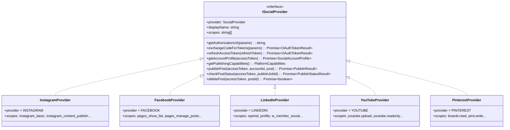

# SAUCER — SOCIAL MEDIA INTEGRATIONS & PROVIDER DIRECTORY

This document details the social media integration engine, OAuth 2.0 flows, token security architecture, and developer approval requirements for **Saucer**.

---

## 1. Social Integration Architecture

All social media providers in Saucer implement the unified `ISocialProvider` interface located in [`src/lib/social/types.ts`](file:///c:/Users/check/Desktop/saucer/src/lib/social/types.ts).

### 1.1 Core Security & Resiliency Controls
1. **AES-256-GCM Authenticated Encryption at Rest**:
   - Access tokens and refresh tokens are encrypted before storage in `SocialAccount`.
   - Stored in format `iv_hex:auth_tag_hex:ciphertext_hex`. Any tampering immediately fails authentication tag verification.
2. **Zero Client-Side Token Exposure**:
   - Frontend endpoints (`/api/social/accounts`) return sanitized account cards. Encrypted and plaintext tokens are never returned in client HTTP responses.
3. **Cryptographic OAuth State & PKCE**:
   - Every authorization URL embeds a 32-byte crypto-random `state` and PKCE `code_verifier`.
   - Stored in `OAuthState` with a 15-minute TTL to defend against replay and CSRF attacks.
4. **Tenant & Workspace Scoping**:
   - Unique database constraint: `[workspaceId, provider, providerAccountId]`.
   - Multi-tenant PostgreSQL Row Level Security (RLS) policies prevent cross-organization account enumeration or manipulation.

---

## 2. Priority 4 Platform Implementation Status

| Platform | Provider Class | Auth Protocol | Formats Supported | Developer App Status & Approval Requirements |
| :--- | :--- | :--- | :--- | :--- |
| **Instagram** | `InstagramProvider` | Meta OAuth 2.0 | Single Image, Carousel (10), Reels Video | **Verified**. Requires Meta App with Instagram Graph API, `instagram_content_publish` permission, and professional Business/Creator account connected to a Facebook Page. Configurable API version (default `v21.0`). |
| **Facebook Pages** | `FacebookProvider` | Meta OAuth 2.0 | Text Posts, Single Image, Multi-Photo, Video Reels | **Verified**. Requires `pages_show_list`, `pages_manage_posts`, `pages_read_engagement` permissions. Uses page-scoped access tokens. Configurable API version (default `v21.0`). |
| **LinkedIn** | `LinkedInProvider` | LinkedIn OAuth 2.0 | Text Posts (3,000 chars), Images, Articles | **Verified**. Supports Member updates (`w_member_social`). Protocol version `202610` (October 2026). Note: Organization Pages require LinkedIn Community Management API approval. |
| **YouTube** | `YouTubeProvider` | Google OAuth 2.0 | Long-form Video, YouTube Shorts | **Verified**. Uses dedicated Video Upload Quota bucket in YouTube Data API v3 rather than deducting from the general 1,600-unit query limit. |
| **Pinterest** | `PinterestProvider` | Pinterest OAuth 2.0 | Visual Pins (Image/Video) + Board Link | **Verified**. Uses Pinterest API v5 with `pins:write` and `boards:read`. |
| **X (Twitter)** | *Deferred* | OAuth 2.0 PKCE | — | **Postponed**. API access deferred until official commercial API costs are evaluated and explicitly approved. |

---

## 3. Platform-Specific Publishing Details

### 3.1 Instagram Business / Creator
- **API Endpoint**: `https://graph.facebook.com/${META_GRAPH_API_VERSION || 'v21.0'}`
- **Publishing Steps**:
  1. Create Container: `POST /{ig-user-id}/media` with `image_url` or `video_url` (with `media_type: "REELS"`).
  2. Poll Container Status: `GET /{container-id}?fields=status_code` (`FINISHED`, `IN_PROGRESS`, `ERROR`).
  3. Publish Container: `POST /{ig-user-id}/media_publish?creation_id={container-id}`.
- **Constraints**: Requires at least 1 image or video (text-only posts not supported by Instagram). Max caption length: 2,200 characters.

### 3.2 Facebook Pages
- **API Endpoint**: `https://graph.facebook.com/${META_GRAPH_API_VERSION || 'v21.0'}`
- **Page Discovery**: `GET /me/accounts` yields managed pages with page-scoped `access_token`.
- **Publishing**: `POST /{page-id}/feed` (text), `POST /{page-id}/photos` (images), `POST /{page-id}/videos` (video).
- **Constraints**: Max text length: 63,206 characters.

### 3.3 LinkedIn (Personal & Company Pages)
- **API Endpoint**: `https://api.linkedin.com/rest/posts` (with `LinkedIn-Version: 202610`)
- **Author Identity**: `urn:li:person:{id}` (profile) or `urn:li:organization:{id}` (company page).
- **Developer Approval Requirements**:
  - `w_member_social`: Included in "Share on LinkedIn" product for individual profiles.
  - `w_organization_social`: Requires official application to the **LinkedIn Community Management API** program with business verification.

### 3.4 YouTube & YouTube Shorts
- **API Endpoint**: `https://www.googleapis.com/youtube/v3/videos`
- **Constraints**: Video attachment required. Titles max 100 characters, descriptions max 5,000 characters.
- **Quota Accounting**: Video upload operations (`videos.insert`) utilize YouTube's separate dedicated Video Upload Quota bucket rather than the legacy 1,600-unit deduction from the core 10,000 daily read/write project quota.

### 3.5 Pinterest
- **API Endpoint**: `https://api.pinterest.com/v5/pins`
- **Constraints**: Requires image URL and target `board_id`. Descriptions max 500 characters, titles max 100 characters.
