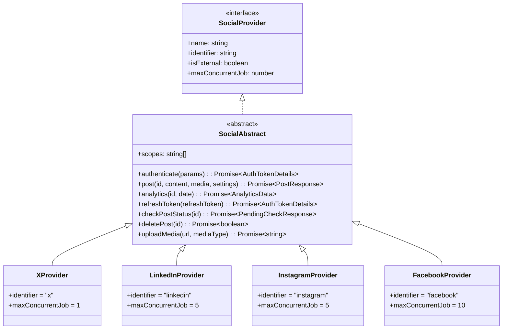

# SAUCER — SOCIAL MEDIA INTEGRATIONS & PROVIDER DIRECTORY

This document provides a comprehensive technical audit of the social media integration engine and an exhaustive catalog of all **38 social providers** supported in the platform.

---

## 1. Social Integration Architecture

All social media providers in Saucer implement the unified `SocialAbstract` class and the `SocialProvider` interface located in the integration subsystem.

### 1.1 Core Resiliency & Security Safeguards
1. **SSRF Defense (`getSsrfSafeDispatcher`)**:
   - For providers supporting self-hosted instances (WordPress, Mastodon, Lemmy, Listmonk), user-supplied URLs are resolved server-side.
   - Any address resolving to RFC 1918 private subnets (`10.0.0.0/8`, `172.16.0.0/12`, `192.168.0.0/16`), loopback (`127.0.0.1`), or link-local (`169.254.0.0/16`) is strictly blocked to prevent Server-Side Request Forgery.
2. **Chunked Streaming & Media Timeout (`MEDIA_READ_TIMEOUT = 120,000ms`)**:
   - High-resolution media files are streamed in chunks directly from object storage to social provider endpoints without buffering entire files in application RAM.
   - Media transfers enforce a strict 2-minute deadline to prevent stalled worker threads.
3. **Temporal Graphene Truncation (`truncateForTemporal`)**:
   - Error messages returned by social APIs can contain huge HTML dumps or base64 echoes.
   - The engine truncates error details before surfacing them to Temporal activities, guaranteeing that gRPC message payloads remain well below the 4MB framework ceiling.
4. **Automated Token Refresh Pipeline**:
   - When a social API returns an authorization error (HTTP 401 or platform code), the activity throws a `RefreshToken` exception.
   - The workflow catches this, invokes `refreshTokenWithCause()`, persists the updated OAuth tokens to the database, and safely retries the activity.

---

## 2. Complete Provider Inventory (38 Providers Audited)

| Identifier | Driver Filename | Auth Protocol | Concurrency Cap | Supported Formats | Analytics Support |
| :--- | :--- | :--- | :---: | :--- | :---: |
| `x` | `x.provider.ts` | OAuth 2.0 PKCE | 1 | Text, Image (4), Video (1), Threads | Yes (Impr, Eng, Likes) |
| `linkedin` | `linkedin.provider.ts` | OAuth 2.0 | 5 | Text, Image, Video, Document/PDF | Yes (Impr, Eng, Clicks) |
| `linkedin-page` | `linkedin.page.provider.ts` | OAuth 2.0 | 5 | Text, Image, Video, Document/PDF | Yes (Org Analytics) |
| `facebook` | `facebook.provider.ts` | OAuth 2.0 (Pages) | 10 | Text, Image, Video, Reels | Yes (Reach, Reactions) |
| `instagram` | `instagram.provider.ts` | Graph API (Business)| 5 | Single Image, Carousel (10), Reels | Yes (Reach, Views, Saves)|
| `instagram-standalone` | `instagram.standalone.provider.ts` | Basic Display / App | 5 | Single Image, Video | Basic |
| `threads` | `threads.provider.ts` | OAuth 2.0 (Meta) | 5 | Text (500 char), Image, Video | Yes (Views, Likes) |
| `youtube` | `youtube.provider.ts` | Google OAuth 2.0 | 2 | Video, Shorts | Yes (Views, Watch Time) |
| `tiktok` | `tiktok.provider.ts` | TikTok Login Kit | 2 | Vertical Video (1080x1920) | Yes (Views, Likes) |
| `tiktok-business` | `tiktok.business.provider.ts` | TikTok Commercial | 2 | Vertical Video, Commercial Audio | Yes (Business Insights) |
| `pinterest` | `pinterest.provider.ts` | OAuth 2.0 | 5 | Pins (Image, Video) + Board Link | Yes (Impressions, Saves) |
| `reddit` | `reddit.provider.ts` | OAuth 2.0 | 2 | Text, Link, Image, Video, Flairs | Yes (Score, Upvote Ratio)|
| `bluesky` | `bluesky.provider.ts` | AT Protocol Agent | 10 | Text (300 char), Image (4), Facets | Basic |
| `mastodon` | `mastodon.provider.ts` | OAuth 2.0 (REST) | 10 | Text (500 char), Image (4), Video | Yes (Boosts, Favs) |
| `gmb` | `gmb.provider.ts` | Google My Business | 5 | Local Updates, Images, Call-to-action| Yes (Calls, Directions) |
| `telegram` | `telegram.provider.ts` | Bot Token | 20 | Text, Markdown, Image, Video | Channel Message Views |
| `discord` | `discord.provider.ts` | Bot Token / Webhook | 20 | Text, Embeds, Attachments | No |
| `slack` | `slack.provider.ts` | OAuth 2.0 Webhooks | 20 | Block Kit, Text, Attachments | No |
| `wordpress` | `wordpress.provider.ts` | Application Password | 5 | Posts, Featured Image, HTML | No |
| `medium` | `medium.provider.ts` | Integration Token | 2 | Markdown Stories, Canonical Links | No |
| `dev.to` | `dev.to.provider.ts` | API Key | 5 | Markdown Articles, Tags | Yes (Reactions, Views) |
| `hashnode` | `hashnode.provider.ts` | Personal Access Token| 5 | Markdown Posts, Publication Slug | Yes (Reactions, Views) |
| `listmonk` | `listmonk.provider.ts` | Basic Auth REST | 5 | HTML Campaigns, List ID | Yes (Open/Click Rates) |
| `farcaster` | `farcaster.provider.ts` | Neynar Managed Signer| 10 | Casts (320 char), Embeds | Yes (Recasts, Likes) |
| `nostr` | `nostr.provider.ts` | NIP-07 / Private Key | 10 | Kind 1 Notes, Relay Broadcasting | No |
| `lemmy` | `lemmy.provider.ts` | User JWT / REST | 5 | Community Posts, Links | Yes (Score, Comments) |
| `dribbble` | `dribbble.provider.ts` | OAuth 2.0 | 2 | Shots (Images), Tags | Yes (Views, Likes) |
| `skool` | `skool.provider.ts` | Webhook / API | 2 | Community Posts | No |
| `whop` | `whop.provider.ts` | API Key | 5 | Store Updates, Announcements | No |
| `kick` | `kick.provider.ts` | Channel Token | 5 | Stream Announcements | No |
| `twitch` | `twitch.provider.ts` | OAuth 2.0 | 2 | Stream Channel Announcements | Yes (Followers) |
| `mewe` | `mewe.provider.ts` | Webhook / API | 2 | Group Posts | No |
| `moltbook` | `moltbook.provider.ts` | Custom REST | 5 | Social Broadcasts | No |
| `tumblr` | `tumblr.provider.ts` | OAuth 1.0a / 2.0 | 5 | Photo, Text, Link Posts | Yes (Notes) |
| `vk` | `vk.provider.ts` | OAuth 2.0 / Wall API | 5 | Wall Posts, Photos | Yes (Views, Likes) |
| `devto` | `dev.to.provider.ts` | API Key | 5 | Articles | Views |
| `mastodon-custom`| `mastodon.custom.provider.ts`| Dynamic Instance OAuth| 5 | Custom Fediverse Posts | Boosts, Favs |
| `listmonk-newsletter`| `listmonk.provider.ts` | Listmonk REST | 5 | Campaign Broadcasts | Open Rates |

---

## 3. Deep-Dive: Core Tier-1 Social Providers

### 3.1 X (Twitter) — `x.provider.ts`
- **Protocol**: OAuth 2.0 Authorization Code with PKCE (`code_challenge` / `code_verifier`).
- **Required Scopes**: `tweet.read`, `tweet.write`, `users.read`, `offline.access`.
- **Concurrency & Rate Limits**:
  - Global worker concurrency pinned to **1** per account.
  - User Tweet rate limit: 100 posts / 15 minutes.
  - Video upload: Chunked INIT, APPEND, FINALIZE, STATUS polling (Max 512MB, H.264 mp4, max 140s).
- **Token Lifecycle**: Access token expires in 2 hours; refresh token is single-use and rotated on every refresh.

### 3.2 LinkedIn (Profile & Page) — `linkedin.provider.ts`
- **Protocol**: OAuth 2.0 Authorization Code.
- **Required Scopes**: `openid`, `profile`, `email`, `w_member_social` (Personal), `w_organization_social` (Company Pages).
- **Media Pipeline**: Multi-step register upload (`assets?action=registerUpload`), PUT binary chunks, verify asset status.
- **Token Lifecycle**: Access token valid for 60 days. Refresh token valid for 365 days.

### 3.3 Meta (Instagram Graph & Facebook Pages) — `instagram.provider.ts`, `facebook.provider.ts`
- **Protocol**: Facebook Graph API v19.0.
- **Required Scopes**: `pages_show_list`, `pages_read_engagement`, `pages_manage_posts`, `instagram_basic`, `instagram_content_publish`.
- **Media Constraints**:
  - Instagram single image: Aspect ratio between 4:5 and 1.91:1 (auto-cropped or letterboxed).
  - Instagram Reels: 9:16 vertical, duration between 5s and 90s, frame rate 23-60 fps.
- **Two-Phase Container Publishing**:
  1. POST media URL to `/media` to create a container.
  2. Poll `/media/{container_id}?fields=status_code` until `FINISHED`.
  3. POST to `/media_publish` with `creation_id`.

### 3.4 YouTube — `youtube.provider.ts`
- **Protocol**: Google OAuth 2.0 with offline access.
- **Required Scopes**: `https://www.googleapis.com/auth/youtube.upload`.
- **Media Pipeline**: Resumable upload protocol; metadata chunk followed by video binary stream.
- **Quota Impact**: Each video upload consumes 1,600 units from the application's daily 10,000 unit developer quota. Strict rate controls required.

---

## 4. Testing & Verification Rules

1. **No Fake Success**: Tests must never simulate successful publication without explicitly labeling the execution as a test-fixture or mock.
2. **Mocked Fixtures**: Automated unit and integration tests utilize recorded HTTP cassettes or typed mock providers (`MockXProvider`, `MockLinkedInProvider`).
3. **Live Gateway Tests**: Production certification requires authenticated execution with test accounts on official platform developer sandboxes.

