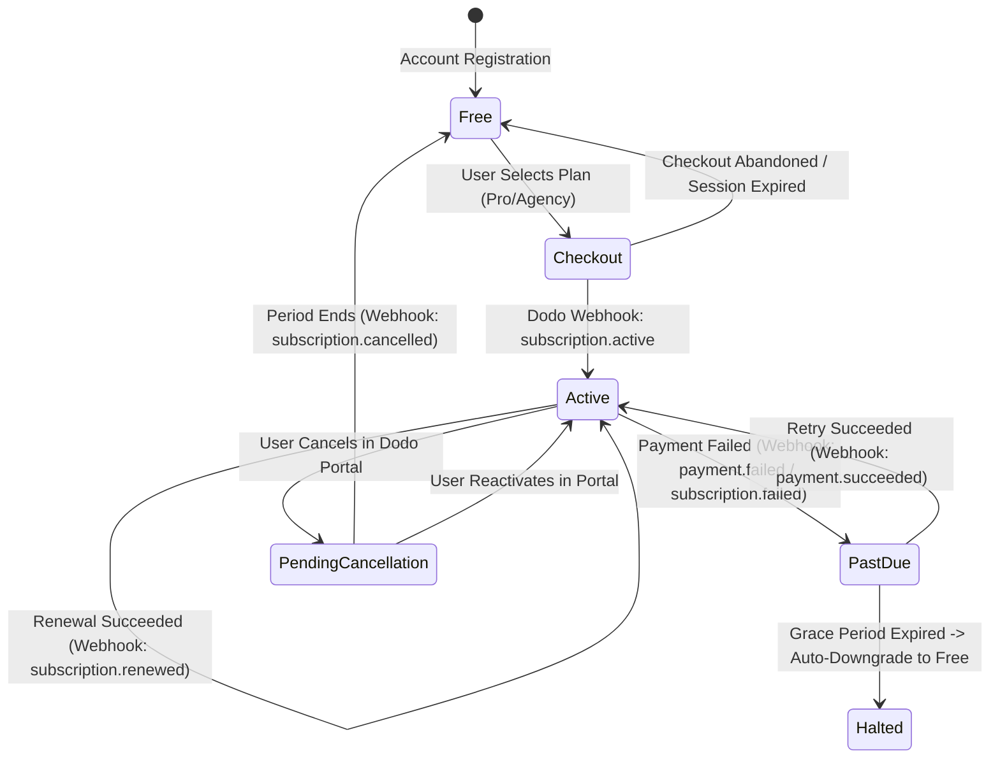

# SAUCER — SUBSCRIPTION & MONETIZATION ARCHITECTURE (DODO PAYMENTS ONLY)

This document details the SaaS subscription architecture, billing lifecycle, tier entitlement matrices, and **Dodo Payments** integration for **Saucer**.

> [!IMPORTANT]
> **EXCLUSIVE PAYMENT PROVIDER**: **Dodo Payments** is the exclusive payment and Merchant of Record (MoR) provider for Saucer. All checkout flows, recurring billing, subscription lifecycle events, customer portals, and one-time add-on purchases operate via Dodo Payments.

---

## 1. Monetization Strategy & Principles

1. **Modern Checkout Sessions**: Uses official Dodo Payments Checkout Sessions rather than deprecated direct tokenization or legacy payment creation APIs.
2. **Server-Side Entitlement Authority**: All tier restrictions (channels, monthly posts, AI allowances, team seats, public API access) are enforced strictly server-side through NestJS guards and CASL authorization policies.
3. **Zero Trust on Client Redirects**: Features are **never** activated based on frontend redirect query parameters (e.g. `?status=success`). Entitlements are granted or revoked **only** through cryptographically verified server-side Dodo Payments webhook events.
4. **Independent AI Credit Ledger**: Subscription payment events synchronize base tier allowances and grant purchased one-time credit packs into the `AiCreditBalance` table. Payment events are strictly forbidden from arbitrarily modifying usage balances or interfering with active reservations.
5. **Strict Test Mode Guardrail**: All development and staging environments operate under `DODO_PAYMENTS_ENVIRONMENT=test_mode`. Live payment collection is never enabled without explicit operational sign-off.

---

## 2. Subscription Plans & Entitlement Matrix

| Feature / Limit Dimension | **Free** | **Pro** | **Agency** | **Enterprise** |
| :--- | :---: | :---: | :---: | :---: |
| **Dodo Product ID** | *Internal / N/A* | `pdt_pro_monthly` / `pdt_pro_yearly` | `pdt_agency_monthly` / `pdt_agency_yearly` | `pdt_enterprise_custom` |
| **Monthly Price (USD)** | **$0** | **$29 / mo** | **$89 / mo** | Custom Pricing |
| **Annual Price (USD)** | **$0** | **$290 / yr** *(Save 17%)* | **$890 / yr** *(Save 17%)* | Custom Pricing |
| **Connected Social Channels** | Up to **3** | Up to **10** | Up to **30** | Unlimited |
| **Scheduled Posts / Month** | 30 posts | Unlimited | Unlimited | Unlimited |
| **Monthly AI Allowance** | 50 credits | 500 credits | 2,500 credits | Custom Allowance |
| **One-Time AI Add-On Packs** | ❌ No | ✅ Yes (Supported) | ✅ Yes (Supported) | ✅ Yes (Volume Discount) |
| **Workspaces / Brands** | 1 | 3 | 10 | Unlimited |
| **Team Member Seats** | 1 (Owner) | 3 seats | 15 seats | Custom |
| **Post Approval Workflows** | ❌ No | ❌ No | ✅ Yes | ✅ Yes |
| **Analytics Retention** | 7 Days | 90 Days | 365 Days | Multi-Year |
| **RSS Auto-Posting** | 1 Feed | 5 Feeds | 20 Feeds | Unlimited |
| **Public REST API & MCP** | ❌ No | ✅ Yes (Basic) | ✅ Yes (High Limit) | Dedicated |
| **Webhook Notifications** | ❌ No | Up to 3 | Up to 20 | Unlimited |
| **Customer Billing Portal** | ❌ No | ✅ Yes (Dodo Portal) | ✅ Yes (Dodo Portal) | ✅ Dedicated Account Manager |

---

## 3. Subscription Lifecycle State Machine



---

## 4. Dodo Payments Integration Architecture

### 4.1 Official SDK Setup
The backend utilizes the official `dodopayments` SDK:

```typescript
import { DodoPayments } from 'dodopayments';

@Injectable()
export class DodoPaymentsService {
  private readonly client: DodoPayments;

  constructor() {
    this.client = new DodoPayments({
      bearerToken: process.env.DODO_PAYMENTS_API_KEY,
      environment: (process.env.DODO_PAYMENTS_ENVIRONMENT as 'test_mode' | 'live_mode') || 'test_mode',
    });
  }

  getClient(): DodoPayments {
    return this.client;
  }
}
```

### 4.2 Checkout Sessions Flow
1. User clicks "Upgrade to Pro" in the Saucer frontend.
2. Frontend calls `POST /api/v1/billing/checkout-session` with the target `tier` and `period`.
3. Backend resolves the matching Dodo Product ID and creates a Checkout Session via the SDK:
   ```typescript
   const session = await this.dodoClient.checkoutSessions.create({
     product_cart: [
       {
         product_id: productId,
         quantity: 1,
       },
     ],
     customer: {
       email: user.email,
       name: user.name || 'Saucer User',
     },
     return_url: `${process.env.DODO_PAYMENTS_RETURN_URL}?session_id={CHECKOUT_SESSION_ID}`,
     metadata: {
       organizationId: org.id,
       userId: user.id,
       tier,
       type: 'subscription',
     },
   });
   ```
4. Backend returns the `checkout_url` to the client.
5. The frontend redirects the user to the secure Dodo Payments hosted checkout page.
6. Upon payment completion, the user returns to `DODO_PAYMENTS_RETURN_URL`. The frontend shows an *"Activating your subscription..."* loading state while awaiting the verified webhook event.

### 4.3 Customer Billing Portal
Saucer delegates payment method updates, invoice downloads, and subscription cancellations to Dodo Payments' secure Customer Portal:
- Endpoint: `POST /api/v1/billing/customer-portal`
- Calls: `this.dodoClient.customers.createCustomerPortalSession({ customer_id: org.dodoCustomerId })`
- Returns the portal URL for seamless one-click redirection.

---

## 5. One-Time AI Credit Pack Purchases

In addition to recurring plans, users on Pro or Agency tiers can purchase non-expiring AI Credit Add-On Packs:
- **Add-On Products**:
  - `pdt_ai_credits_500`: 500 Credits ($10)
  - `pdt_ai_credits_2000`: 2,000 Credits ($30)
- **Flow**:
  1. Backend initiates a one-time product Checkout Session (`metadata: { type: 'credit_pack', creditAmount: 500 }`).
  2. On verified `payment.succeeded` webhook, backend executes:
     ```typescript
     await this.prisma.aiCreditBalance.update({
       where: { organizationId: orgId },
       data: { bonusCredits: { increment: 500 } }
     });
     ```
  3. Logs an audit record in `AiCreditTransaction` with `type: PURCHASE`.
  4. Note: AI usage balances (`usedCredits` and `reservedCredits`) are **never modified** by payment events.

---

## 6. Dodo Webhook Verification & Idempotent Processing

Webhooks arrive at `POST /api/v1/billing/dodo/webhook`.

### 6.1 Cryptographic Signature Verification
Dodo Payments utilizes standard webhook signing headers (`webhook-id`, `webhook-signature`, `webhook-timestamp`):

```typescript
import { Webhook } from 'standardwebhooks'; // Or official Dodo unwrap

@Post('/dodo/webhook')
async handleWebhook(
  @Req() req: RawBodyRequest<Request>,
  @Headers() headers: Record<string, string>
) {
  const webhookKey = process.env.DODO_PAYMENTS_WEBHOOK_KEY;
  if (!webhookKey) {
    throw new Error('DODO_PAYMENTS_WEBHOOK_KEY is not configured');
  }

  const rawBody = req.rawBody.toString();
  const wh = new Webhook(webhookKey);

  let event: any;
  try {
    event = wh.verify(rawBody, headers);
  } catch (err) {
    this.logger.error(`Webhook signature verification failed: ${err.message}`);
    throw new UnauthorizedException('Invalid Dodo Payments webhook signature');
  }

  // 1. Idempotency Check: prevent duplicate execution
  const eventId = headers['webhook-id'] || event.id;
  const alreadyProcessed = await this.prisma.paymentEvent.findUnique({
    where: { id: eventId },
  });

  if (alreadyProcessed) {
    return { status: 'already_processed' };
  }

  // 2. Dispatch domain logic
  await this.processDodoEvent(event);

  // 3. Record event in PaymentEvent table for auditing and replay defense
  await this.prisma.paymentEvent.create({
    data: {
      id: eventId,
      subscriptionId: event.data?.subscription_id || 'one_time',
      event: event.type,
      payload: rawBody,
      signatureValid: true,
    },
  });

  return { status: 'success' };
}
```

---

## 7. Webhook Event Mapping Catalog

| Dodo Webhook Event | Saucer Action & Entitlement Impact | AI Credit Impact |
| :--- | :--- | :--- |
| **`subscription.active`** | Updates `Subscription` table: `status = ACTIVE`, stores `dodoSubscriptionId`, `dodoCustomerId`. Sets channel limits. | Synchronizes `totalAllowance` to plan quota (500 for Pro, 2500 for Agency). |
| **`subscription.renewed`** | Updates `currentPeriodEnd` to next billing date. Resets monthly post counts. | Resets `usedCredits` to 0. Clears expired holds. Rolls over non-expiring `bonusCredits`. |
| **`subscription.updated`** | Updates tier if upgraded/downgraded. Adjusts channel and feature entitlements immediately. | Updates `totalAllowance` to new tier quota. |
| **`subscription.cancelled`** | Sets `cancelAt` date. Entitlements remain active until billing period expires. | No immediate credit modification; resets to Free allowance upon period expiry. |
| **`subscription.failed`** / **`payment.failed`** | Marks `status = PAST_DUE`. Sends alert email to workspace admin. 3-day grace period before downgrade. | Freezes new generation if account becomes delinquent. |
| **`payment.succeeded`** *(One-time)* | Verifies metadata. If `type == 'credit_pack'`, increments `bonusCredits`. | Atomically adds purchased credits to `bonusCredits`. |
| **`refund.succeeded`** | If subscription refund: immediately downgrades to Free. If credit pack refund: deducts `bonusCredits`. | Safely adjusts `bonusCredits` if unspent. |

---

## 8. Policy Enforcement (CASL Integration)

Backend route handlers enforce active tier allowances via CASL guards:

```typescript
const { subscription, options } = await this.getPackageOptions(orgId);

// Verify connected channel limit
if (section === Sections.CHANNEL) {
  const activeCount = await this.integrationService.getActiveCount(orgId);
  const allowed = subscription?.totalChannels || options.channel;
  if (activeCount >= allowed) {
    throw new SubscriptionException(
      `Your ${subscription?.subscriptionTier || 'FREE'} plan allows up to ${allowed} connected channels. Please upgrade in Billing.`
    );
  }
}
```
