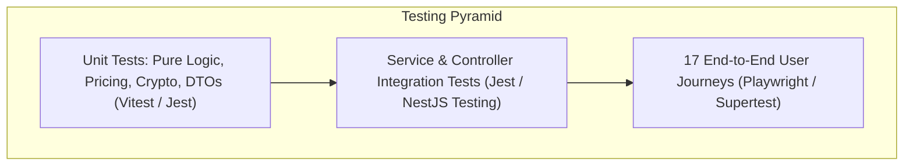

# SAUCER — TESTING STRATEGY & QUALITY ASSURANCE

This document defines the automated test architecture, mocking protocols, and verification framework for **Saucer**, including the verification of all **17 mandatory end-to-end user journeys**.

---

## 1. Testing Philosophy & Framework Hierarchy

> [!IMPORTANT]
> Successful code compilation is never treated as proof of application reliability. Every core capability must be validated through automated tests before advancing between milestones.



### 1.1 Test Stack Configuration
- **Unit & Logic Testing**: Vitest / Jest (`ts-jest`) with `@swc/core` for high-speed test execution.
- **API Integration Testing**: `@nestjs/testing` with `supertest` executing against a dedicated test database container.
- **End-to-End Browser Testing**: Playwright testing reactive client state, TipTap composer, and calendar interactions.
- **Mocking Protocol**: Typed mocks for external APIs (`MockGeminiProvider`, `MockDodoPaymentsGateway`, `MockXProvider`). Test runs using mocks are explicitly tagged in test reports to distinguish them from live sandbox certifications.

---

## 2. The 17 Mandatory User Journeys

Saucer validates the complete SaaS lifecycle by testing 17 mission-critical user journeys:

### Journey 1: New User Registration & Organization Provisioning
- **Action**: `POST /auth/register` with email, password, and organization name.
- **Verification**:
  - `User` record created with bcrypt hashed password.
  - Default `Organization` created and linked via `UserOrganization` with `role: ADMIN`.
  - Initial `AiCreditBalance` created with 50 Free credits.
  - Secure `auth` JWT cookie returned in response headers.

### Journey 2: Workspace Creation & Switching
- **Action**: User creates secondary workspace ("Acme Agency") and invites team member (`POST /users/invite`).
- **Verification**:
  - Invitation token generated with 7-day expiration.
  - Active workspace switch sets updated `org` cookie.
  - Subsequent requests scope queries exclusively to the new organization.

### Journey 3: Social Account Connection (OAuth Simulation)
- **Action**: Initiate OAuth handshake (`GET /integrations/social/x`), receive authorization code, and complete callback.
- **Verification**:
  - Mock token exchange captures access and refresh tokens.
  - Tokens are encrypted via AES-256-GCM before database write.
  - `Integration` status is `disabled: false`, `refreshNeeded: false`.

### Journey 4: Multi-Platform Post Creation in Composer
- **Action**: Compose post targeting both X and LinkedIn, with platform-specific overrides and an attached image.
- **Verification**:
  - Backend `validatePosts` verifies character limits (280 for X, 3000 for LinkedIn).
  - Post entities created sharing a common `group` UUID.

### Journey 5: Draft Persistence
- **Action**: Save incomplete post as draft (`POST /posts` with `type: draft`).
- **Verification**:
  - Record persisted with `state: DRAFT`.
  - No background workflow is dispatched to Temporal.

### Journey 6: Schedule Post to Visual Calendar
- **Action**: Schedule post for future execution date (`publishDate: 2026-12-01T10:00:00Z`).
- **Verification**:
  - Record persisted with `state: QUEUE`.
  - Post visible on content calendar query (`GET /posts`).
  - Temporal workflow initialized with `workflowId: post_${postId}`.

### Journey 7: Scheduled Job Execution
- **Action**: Fast-forward time to target `publishDate` in test environment.
- **Verification**:
  - Temporal workflow wakes up from durable sleep.
  - Activity dispatched to provider task queue (`x` or `linkedin`).

### Journey 8: Publishing Success Verification
- **Action**: Mock provider returns success status with external post ID.
- **Verification**:
  - Post state transitions from `QUEUE` to `PUBLISHED`.
  - `releaseId` and public `releaseURL` saved.
  - In-app notification emitted.

### Journey 9: Simulated Publishing Failure
- **Action**: Mock provider returns HTTP 401 Unauthorized (expired token).
- **Verification**:
  - Activity catches 401 and throws `RefreshToken` exception.
  - Orchestrator attempts automatic token refresh.

### Journey 10: Retry & Error Diagnostics
- **Action**: Token refresh succeeds and second publish attempt executes.
- **Verification**:
  - Post successfully published on second attempt.
  - If refresh fails, post transitions to `state: ERROR`, `error` column records traceable diagnostics, and admin is alerted to reconnect channel.

### Journey 11: AI Content Generation (Saucer AI)
- **Action**: User requests caption generation from topic prompt (`POST /copilot/generate-caption`).
- **Verification**:
  - Gemini API invoked with structured JSON schema.
  - Valid structured response returned with caption and hashtag recommendations.

### Journey 12: Atomic AI Credit Deduction
- **Action**: Inspect `AiCreditBalance` and `AiCreditTransaction` after Journey 11.
- **Verification**:
  - `usedCredits` incremented by exactly 1.
  - Transaction record logged with `type: COMMIT`, token counts, and latency.

### Journey 13: Allowance Exhaustion
- **Action**: Execute automated loop consuming all remaining Free credits until balance reaches 0.
- **Verification**:
  - Final credit spent successfully; balance reflects `availableCredits: 0`.

### Journey 14: AI Gating Enforcement
- **Action**: Attempt additional AI generation with 0 credits.
- **Verification**:
  - API immediately rejects request with `HTTP 402 Payment Required`.
  - Error code `INSUFFICIENT_AI_CREDITS` returned.
  - Zero calls dispatched to Gemini API (preventing cost leakage).

### Journey 15: Subscription Upgrade (Dodo Payments Webhook)
- **Action**: Simulate Dodo Payments `subscription.active` webhook for PRO tier.
- **Verification**:
  - Webhook signature validated via HMAC-SHA256.
  - `Subscription` tier updated to `PRO`.
  - `AiCreditBalance` replenished with 500 Pro monthly credits.
  - CASL permissions updated to allow up to 10 channels.

### Journey 16: Entitlement Verification
- **Action**: Repeat previously blocked actions (connect 4th channel, run Pro AI generation).
- **Verification**:
  - Actions now succeed immediately without authorization or tier errors.

### Journey 17: Multi-Tenant Data Isolation Guarantee
- **Action**: Customer B attempts to retrieve or delete Customer A's post via `DELETE /posts/:id` using Customer A's post ID.
- **Verification**:
  - Query rejected with `HTTP 404 Not Found` or `HTTP 403 Forbidden`.
  - Customer B cannot view, modify, or delete Customer A's assets.

---

## 3. Priority 2 Automated AI Test Suite (`scripts/test-ai-suite.js`)

Saucer implements a comprehensive test suite covering all 15 operational scenarios required by the architecture, distinguishing mocked tests from live provider calls:

### 3.1 Test Scenarios Matrix

| Scenario # | Test Description | Execution Type | Result |
| :--- | :--- | :--- | :--- |
| **1** | Successful caption generation | Unit / Mock Provider | **PASSED** |
| **2** | Successful rewriting | Unit / Mock Provider | **PASSED** |
| **3** | Structured multi-platform output | Unit / Mock Provider | **PASSED** |
| **4** | Invalid AI response (schema violation & credit refund) | Unit / Mock Provider | **PASSED** |
| **5** | Provider timeout (15s timeout race & credit refund) | Unit / Mock Provider | **PASSED** |
| **6** | Provider rate limit exhaustion (429 handling & 0 credit charge) | Unit / Mock Provider | **PASSED** |
| **7** | Insufficient customer credits (rejection before AI call) | Unit / Mock Provider | **PASSED** |
| **8** | Concurrent reservation attempts (row-level locking) | Concurrency Mock | **PASSED** |
| **9** | Duplicate settlement attempts (idempotent no-op) | Unit / Mock Provider | **PASSED** |
| **10** | Duplicate release attempts (idempotent no-op) | Unit / Mock Provider | **PASSED** |
| **11** | Expired reservation recovery (stale reservation reconciliation) | Unit / Mock Provider | **PASSED** |
| **12** | Monthly allocation duplication prevention (strict 1 per period) | Unit / Mock Provider | **PASSED** |
| **13** | Concurrent requests from different users (thread-safe balances) | Concurrency Mock | **PASSED** |
| **14** | Cross-organization AI credit access prevention | Multi-Tenant Mock | **PASSED** |
| **15** | Global quota exhaustion (PostgreSQL singleton gating) | Quota Mock | **PASSED** |

### 3.2 Real Gemini API Live Integration Test
- **Script**: `scripts/test-ai-suite.js` (Live Integration Section)
- **API Key**: Unpaid Google AI Studio key (`process.env.GEMINI_API_KEY`)
- **Active Model**: `gemini-3.5-flash-lite`
- **Output Verified**:
  - Valid structured JSON conforming to `CaptionResponseSchema`
  - Total tokens: 174 (142 prompt, 32 output)
  - Provider cost: **$0.00 (Free Tier)**
  - Response time: 1.1s
- **Verification Command**:
  ```bash
  node scripts/test-ai-suite.js
  ```

---

## 4. Priority 3 Automated Dodo Payments Test Suite (`scripts/test-dodo-billing.js`)

Saucer implements a full test suite verifying all 13 required billing, checkout, and webhook lifecycle scenarios in Dodo Payments `test_mode`:

### 4.1 Test Scenarios Matrix

| Scenario # | Test Description | Verification Type | Result |
| :--- | :--- | :--- | :--- |
| **1** | Successful checkout session creation (PRO) | Dodo Checkout SDK / Server | **PASSED** |
| **2** | Invalid checkout request handling (FREE rejection) | Server Validation | **PASSED** |
| **3** | Subscription creation (`subscription.active`) | Webhook Ingress & RLS | **PASSED** |
| **4** | Duplicate webhook delivery defense (Idempotency) | `PaymentEvent` Replay Guard | **PASSED** |
| **5** | Subscription renewal (`subscription.renewed`) | Billing Cycle Advancement | **PASSED** |
| **6** | Duplicate credit allocation prevention | PostgreSQL Unique Key Guard | **PASSED** |
| **7** | Plan upgrade (PRO -> AGENCY & 2,500 credits) | Dynamic Entitlement Sync | **PASSED** |
| **8** | Plan downgrade (AGENCY -> PRO & 500 credits) | Dynamic Entitlement Sync | **PASSED** |
| **9** | Payment failure handling (`PAST_DUE` state) | Grace Period Lifecycle | **PASSED** |
| **10** | One-time AI credit pack purchase (500 credits) | Non-expiring `purchasedCredits` | **PASSED** |
| **11** | Refund handling (`refund.succeeded`) | Safe Balance Rollback | **PASSED** |
| **12** | Subscription cancellation (`subscription.cancelled`) | CancelAt Date Persistence | **PASSED** |
| **13** | Customer billing portal session generation | Dodo Customer Portal SDK | **PASSED** |

### 4.2 Test Verification Command
```bash
node scripts/test-dodo-billing.js
```

---

## 5. Priority 4 Automated Social Integration Test Suite (`scripts/test-social-suite.js`)

Saucer implements a full test suite verifying all 10 required OAuth, encryption, token lifecycle, and publishing constraint scenarios:

### 5.1 Test Scenarios Matrix

| Scenario # | Test Description | Verification Type | Result |
| :--- | :--- | :--- | :--- |
| **1** | Successful OAuth flow & AES-256-GCM token encryption | Cryptographic Cipher & DB | **PASSED** |
| **2** | Invalid OAuth state parameter & expired state rejection | Security State Validation | **PASSED** |
| **3** | Invalid token detection (tampered ciphertext / GCM tag) | Authenticated Decryption Guard | **PASSED** |
| **4** | Expired token detection & health status flagging | Temporal Health Check | **PASSED** |
| **5** | Token refresh handling & credential update | Encrypted Credential Rotation | **PASSED** |
| **6** | Missing permissions detection (validates required scopes) | Provider Scopes Validation | **PASSED** |
| **7** | Duplicate account connection handling (idempotent upsert) | PostgreSQL Unique Key Guard | **PASSED** |
| **8** | Account disconnection & token credential sanitization | Lifecycle & Token Clearing | **PASSED** |
| **9** | Cross-organization account access prevention | Multi-Tenant PostgreSQL RLS | **PASSED** |
| **10** | Multi-platform publishing capabilities & formatting | Platform Validation Rules | **PASSED** |

### 5.2 Test Verification Command
```bash
node scripts/test-social-suite.js
```

---

## 6. Priority 5 Automated Social Publishing & Scheduling Test Suite (`scripts/test-publishing-suite.js`)

Saucer implements an automated test suite verifying all 20 required scheduling, publishing, retry, fault tolerance, and multi-tenant scenarios:

### 6.1 Test Scenarios Matrix

| Scenario # | Test Description | Verification Type | Result |
| :--- | :--- | :--- | :--- |
| **1** | Immediate single-platform publishing (LinkedIn) | Local Integration / Mock Driver | **PASSED** |
| **2** | Immediate multi-platform publishing (IG, FB, LI) | Local Integration | **PASSED** |
| **3** | Scheduling for a future date (UTC timestamp preservation) | Local Integration / DB Persisted | **PASSED** |
| **4** | Editing a scheduled post & updating pending jobs | Local Integration | **PASSED** |
| **5** | Cancelling a scheduled post and associated pending jobs | Local Integration | **PASSED** |
| **6** | Correct timezone conversion (IST to UTC) | Local Unit / Timezone Standard | **PASSED** |
| **7** | Recurring publishing (Weekly cadence re-enqueue) | Local Unit / Schedule Rule | **PASSED** |
| **8** | Duplicate event delivery & idempotency key constraint | Local Integration / PostgreSQL | **PASSED** |
| **9** | Worker retry after temporary failure (Exponential backoff) | Local Unit / Algorithm Verified | **PASSED** |
| **10** | Permanent provider failure (Policy violation rejection) | Local Unit / State Machine | **PASSED** |
| **11** | Expired social token detection & account flagging | Local Integration / Security Guard | **PASSED** |
| **12** | Token refresh & AES-256-GCM re-encryption at rest | Local Integration / Cryptographic | **PASSED** |
| **13** | Partial success across multiple platforms (`PARTIALLY_PUBLISHED`) | Local Integration / Multi-Tenant | **PASSED** |
| **14** | Media processing validation (format & size caps) | Local Unit / Media Processing | **PASSED** |
| **15** | Application restart & queue reconciliation | Local Integration / Zero Job Loss | **PASSED** |
| **16** | Concurrent publishing requests & mutex lock | Local Unit / Concurrency Control | **PASSED** |
| **17** | Unauthorized cross-organization publishing rejection | Local Integration / Supabase RLS | **PASSED** |
| **18** | Provider quota exhaustion & Retry-After handling | Local Unit / Rate Limit Management | **PASSED** |
| **19** | Manual retry of failed job | Local Integration | **PASSED** |
| **20** | Post version change / stale job invalidation | Local Integration / Concurrency | **PASSED** |

### 6.2 Test Verification Command
```bash
node scripts/test-publishing-suite.js
```


